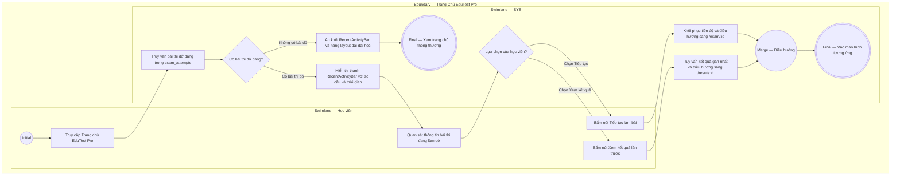

# EPIC01-US01 - Xem Dashboard Khảo Thí & Tiếp Tục Bài Thi Dở

## Preconditions
- Người dùng đã truy cập nền tảng EduTest Pro với phiên đăng nhập học viên hợp lệ.
- Học viên có ít nhất một bài thi đang làm dở dang trên hệ thống có trạng thái `in_progress` lưu trong cơ sở dữ liệu.

## Trigger
- Học viên truy cập trang chủ hoặc bấm vào Logo CertPrep / Menu "Trang chủ" trên Navbar.
- Màn hình liên quan: Giao diện Trang chủ (`/`), Khối Hoạt động gần đây (`RecentActivityBar`).

## Main Flow

1. Học viên truy cập vào Trang chủ EduTest Pro (`/`).
2. SYS truy vấn cơ sở dữ liệu tìm kiếm bản ghi bài thi chưa hoàn thành gần nhất (`exam_attempts` có `status = 'in_progress'`) của học viên.
3. SYS hiển thị khối tóm tắt bài thi đang làm dở gồm: Tiêu đề đề thi, phần thi đang dừng lại, số câu đã trả lời / tổng số câu, và thời gian làm bài còn lại.
4. Học viên bấm nút [ Tiếp tục làm bài ].
5. SYS lưu mã đề thi vào phiên làm việc (`activeExamId`), khôi phục trạng thái đồng hồ đếm ngược và điều hướng học viên vào phòng thi `/exam/[id]`.

- **Business rules / logic:**
  - Nếu học viên có nhiều bài thi dở, hệ thống ưu tiên hiển thị bài thi có thời điểm cập nhật mới nhất (`started_at` hoặc `updated_at` gần nhất).
  - Thời gian còn lại được tính dựa trên số giây đã lưu `remaining_seconds_saved`; nếu thời gian còn lại $\le 0$, bài thi tự động chuyển trạng thái `completed` và không hiển thị trên thanh làm dở.
  - Số câu đã trả lời được tính bằng số lượng bản ghi `exam_attempt_answers` có `user_answer IS NOT NULL`.

### Field-level specification — Màn hình Khối Hoạt Động Gần Nhất (RecentActivityBar)
| Field / control | Loại UI Control | State | Required | Conditional / dynamic | Source / validation |
| :--- | :--- | :--- | :--- | :--- | :--- |
| **Nhãn trạng thái** | `Badge Text` | `READONLY` | `optional` | `Không` | Chuỗi cố định `"Đang làm dở"` |
| **Danh mục bài thi** | `Text Label` | `READONLY` | `optional` | `DYNAMIC` | Lấy từ `exams.category_label` (ví dụ: `"IELTS Academic Reading"`) |
| **Tên đề thi dở dang** | `Typography Heading` | `READONLY` | `required` | `DYNAMIC` | Lấy từ `exams.title` của bài thi đang làm |
| **Tiến độ số câu** | `Text Label` | `READONLY` | `required` | `AUTO-FILL` | Hiển thị chuỗi `"Đã trả lời X/Y câu hỏi"` tính từ `exam_attempts` |
| **Thời gian còn lại** | `Text Label` | `READONLY` | `required` | `AUTO-FILL` | Định dạng `"Còn MM phút SS giây"` từ `remaining_seconds_saved` |
| **Nút Tiếp tục làm bài** | `Button Action` | `USER-INPUT` | `required` | `Không` | Điều hướng sang `/exam/[id]` của đề thi dở |
| **Nút Xem kết quả lần trước** | `Button Action` | `USER-INPUT` | `optional` | `CONDITIONAL` • Hiện khi học viên đã có ít nhất 1 bài thi hoàn thành trước đó. • Ẩn khi học viên là người dùng mới chưa từng nộp bài nào. | Điều hướng sang `/result/[id]` của lần thi gần nhất |

## Alternate Flows

### AF-01 — Không có bài thi nào đang làm dở
1. Tại bước 2, SYS kiểm tra không tìm thấy bản ghi `exam_attempts` nào ở trạng thái `in_progress`.
2. SYS ẩn toàn bộ khối `RecentActivityBar` khỏi giao diện Trang chủ và đẩy phần dải đối tác đại học lên sát Hero Section.

### AF-02 — Học viên chọn Xem kết quả lần trước
1. Tại bước 4, thay vì tiếp tục làm bài dở, học viên bấm nút [ Xem kết quả lần trước ].
2. SYS truy vấn bài thi hoàn thành gần nhất (`status = 'completed'`) và điều hướng học viên sang trang `/result/[id]`.

## Exception Flows

- **Đề thi đã bị gỡ bỏ hoặc khóa:** Đề thi dở dang bị quản trị viên gỡ bỏ (`is_published = false`) $\rightarrow$ SYS hiển thị thông báo lỗi "Đề thi này hiện không còn khả dụng", hủy trạng thái dở dang của bài thi và tải lại trang chủ.

## Activity Diagram — Swimlane
**Trigger:** Học viên truy cập trang chủ và thao tác với khối bài thi đang làm dở.

