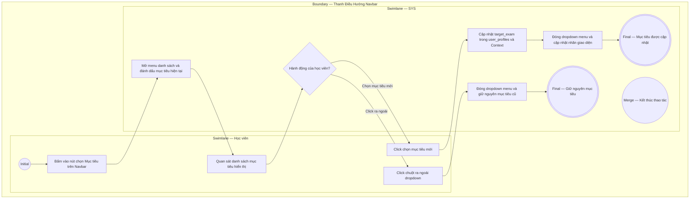

# EPIC01-US02 - Lựa Chọn & Cập Nhật Mục Tiêu Chứng Chỉ

## Preconditions
- Người dùng đã truy cập nền tảng EduTest Pro với phiên đăng nhập học viên hợp lệ.
- Danh mục các mục tiêu chứng chỉ (`IELTS 7.5+`, `CFA Level 1`, `HSK 5 - 6`, `TOEIC 850+`, `GMAT Focus`) đã được cấu hình trong hệ thống.

## Trigger
- Học viên bấm vào bộ chọn mục tiêu (Target Selector) trên thanh Header Navbar (`#target-selector-btn`).
- Màn hình liên quan: Menu thả xuống chọn chứng chỉ mục tiêu trên Navbar (`#target-dropdown-menu`).

## Main Flow

1. Học viên bấm vào nút [ Mục tiêu: <Tên mục tiêu hiện tại> ] trên Navbar.
2. SYS hiển thị danh sách các mục tiêu chứng chỉ có sẵn kèm dấu tích xanh ở mục tiêu đang chọn.
3. Học viên click chọn một mục tiêu mới (ví dụ: `CFA Level 1`).
4. SYS cập nhật trạng thái mục tiêu `target_exam` trong cơ sở dữ liệu `user_profiles`, tự động đóng dropdown menu và cập nhật nhãn hiển thị tức thì trên toàn bộ giao diện (bao gồm nhãn Navbar và bộ lọc từ vựng trọng tâm).

- **Business rules / logic:**
  - Mục tiêu đã chọn được lưu vào bộ nhớ cục bộ (Local Storage/Context) và đồng bộ vào trường `target_exam` của bảng `user_profiles`.
  - Thay đổi mục tiêu sẽ tự động cập nhật nhãn hiển thị tại nút tra cứu từ vựng trên thanh Top Utility Bar (ví dụ: "Từ vựng trọng tâm (CFA Level 1)").

### Field-level specification — Khung Header Navbar (Target Selector)
| Field / control | Loại UI Control | State | Required | Conditional / dynamic | Source / validation |
| :--- | :--- | :--- | :--- | :--- | :--- |
| **Nút mở Menu Mục Tiêu** | `Dropdown Trigger` | `USER-INPUT` | `required` | `Không` | Kích hoạt mở danh sách tùy chọn |
| **Nhãn mục tiêu hiện tại** | `Text Label` | `READONLY` | `required` | `DYNAMIC` | Lấy từ `user_profiles.target_exam` |
| **Icon mũi tên thả xuống** | `Icon Graphic` | `READONLY` | `optional` | `DYNAMIC` | Xoay 180 độ khi menu đang mở |
| **Danh sách tùy chọn mục tiêu**| `List Option Button`| `USER-INPUT`| `required` | `Không` | Danh sách 5 mục tiêu: IELTS 7.5+, CFA Level 1, HSK 5-6, TOEIC 850+, GMAT Focus |
| **Icon đánh dấu đã chọn** | `Icon Graphic` | `READONLY` | `optional` | `CONDITIONAL` • Hiện tại dòng mục tiêu đang được chọn. • Ẩn tại các dòng mục tiêu khác. | Hiển thị icon Check màu xanh đậm |

## Alternate Flows

### AF-01 — Đóng menu mà không thay đổi mục tiêu
1. Tại bước 2, học viên click chuột ra ngoài vùng dropdown menu hoặc bấm lại vào nút kích hoạt.
2. SYS đóng menu và giữ nguyên mục tiêu chứng chỉ hiện tại mà không thực hiện thao tác lưu dữ liệu.

## Exception Flows

- **Lỗi mất kết nối mạng:** Học viên chọn mục tiêu mới khi mạng bị gián đoạn $\rightarrow$ SYS lưu tạm vào Client State, hiển thị toast thông báo cảnh báo "Không thể đồng bộ lên máy chủ, đang lưu tạm tại máy" và tự động gửi lại khi có mạng.

## Activity Diagram — Swimlane
**Trigger:** Học viên bấm vào bộ chọn mục tiêu trên Navbar.

