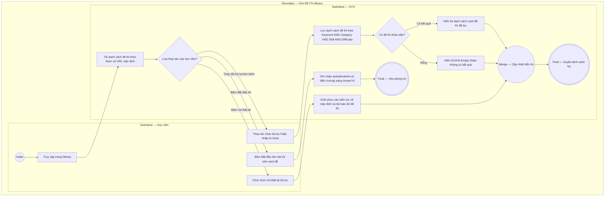

# EPIC02-US01 - Tìm Kiếm & Lọc Đề Thi Đa Tiêu Chí

## Preconditions
- Người dùng đã truy cập trang Kho đề thi (`/library`).
- Ngân hàng đề thi với đầy đủ các thuộc tính danh mục (`category`), kỹ năng (`skill`), độ khó (`difficulty`), và thẻ nhãn (`tags`) đã tồn tại trong cơ sở dữ liệu.

## Trigger
- Học viên tương tác với ô tìm kiếm hoặc các nút lọc tại Sidebar bên trái của trang Kho đề thi.
- Màn hình liên quan: Màn hình Kho đề thi (`/library`), Sidebar bộ lọc (`FilterSidebar`).

## Main Flow

1. Học viên vào trang Kho đề thi (`/library`).
2. SYS hiển thị danh sách toàn bộ đề thi có sẵn kèm số lượng đếm tại Header.
3. Học viên chọn một hệ thống chứng chỉ (ví dụ: click chọn `HSK (Cấp độ 1 - 6)`).
4. SYS tự động cập nhật danh sách đề thi chỉ hiển thị các đề thuộc nhóm HSK, đồng thời cập nhật thanh thống kê số lượng đề thi tìm thấy.
5. Học viên nhập thêm từ khóa vào ô tìm kiếm (ví dụ: `"Đề 02"`).
6. SYS kết hợp điều kiện lọc (chứng chỉ = HSK VÀ tiêu đề chứa "Đề 02") để lọc dữ liệu theo thời gian thực (Client-side / API query).

- **Business rules / logic:**
  - Bộ lọc hỗ trợ kết hợp đồng thời 4 tiêu chí: Từ khóa AND Chứng chỉ AND Kỹ năng AND Độ khó.
  - Khi bấm nút [ Đặt lại ] tại đầu Sidebar, toàn bộ các tiêu chí lọc được khôi phục về giá trị mặc định (`category = 'all'`, `skill = 'all'`, `difficulty = 'all'`, `searchQuery = ''`).
  - Sắp xếp (Sort by) hỗ trợ 3 chế độ: Phổ biến nhất (số câu hỏi / lượt làm), Đánh giá cao nhất (theo trường `rating`), và Mới nhất (`created_at`).

### Field-level specification — Màn hình Kho Đề Thi & Bộ Lọc (LibraryFilterScreen)
| Field / control | Loại UI Control | State | Required | Conditional / dynamic | Source / validation |
| :--- | :--- | :--- | :--- | :--- | :--- |
| **Nút Đặt lại bộ lọc** | `Button Action` | `USER-INPUT` | `optional` | `Không` | Đặt lại toàn bộ filter về trạng thái ban đầu |
| **Ô tìm kiếm từ khóa** | `Text Input` | `USER-INPUT` | `optional` | `TRIGGER` | Lọc theo chuỗi ký tự không phân biệt hoa thường |
| **Nút lọc Tất cả chứng chỉ** | `Filter Button` | `USER-INPUT` | `required` | `DYNAMIC` | Hiển thị tổng số lượng đề thi trong hệ thống |
| **Nhóm lọc Khối Ngoại ngữ** | `List Buttons` | `USER-INPUT` | `optional` | `DYNAMIC` | Danh sách 4 chứng chỉ: IELTS, HSK, TOEIC, TOEFL |
| **Nhóm lọc Khối Kinh tế** | `List Buttons` | `USER-INPUT` | `optional` | `DYNAMIC` | Danh sách 4 chứng chỉ: CFA, GMAT, ACCA, GRE |
| **Bộ lọc Kỹ năng khảo thí** | `Radio / Pills` | `USER-INPUT` | `optional` | `DYNAMIC` | Các tùy chọn: Tất cả kỹ năng, Đọc hiểu (Reading), Nghe hiểu (Listening) |
| **Bộ lọc Độ khó đề thi** | `Radio / Pills` | `USER-INPUT` | `optional` | `DYNAMIC` | Các mức: Tất cả, Cơ bản (Band 5.x), Trung cấp (Band 6.x), Nâng cao (Band 7.x - 8.x+) |
| **Dropdown sắp xếp kết quả** | `Select Dropdown` | `USER-INPUT` | `optional` | `DYNAMIC` | 3 tùy chọn: Phổ biến nhất, Đánh giá cao, Mới nhất |
| **Nút Bắt đầu làm bài thi** | `Button Action` | `USER-INPUT` | `required` | `Không` | Điều hướng sang `/exam/[id]` của đề tương ứng |

## Alternate Flows

### AF-01 — Học viên bấm nút Đặt lại bộ lọc
1. Học viên bấm nút [ Đặt lại ] tại góc trên của Sidebar.
2. SYS xóa toàn bộ từ khóa, đặt lại tất cả các danh mục và hiển thị danh sách đầy đủ ban đầu.

### AF-02 — Bộ lọc không có kết quả phù hợp (Empty State)
1. Tổ hợp tiêu chí lọc của học viên không khớp với bất kỳ đề thi nào trong CSDL.
2. SYS hiển thị khối Empty State với thông điệp: "Không tìm thấy đề thi nào phù hợp với bộ lọc hiện tại" kèm nút bấm [ Đặt lại bộ lọc ].

## Exception Flows

- **Lỗi tải dữ liệu đề thi từ máy chủ:** Mất kết nối API $\rightarrow$ SYS hiển thị thông báo "Không thể kết nối đến máy chủ khảo thí, vui lòng thử lại" kèm nút [ Tải lại trang ].

## Activity Diagram — Swimlane
**Trigger:** Học viên chọn các tiêu chí lọc hoặc nhập từ khóa tìm kiếm trong Thư viện đề thi.

