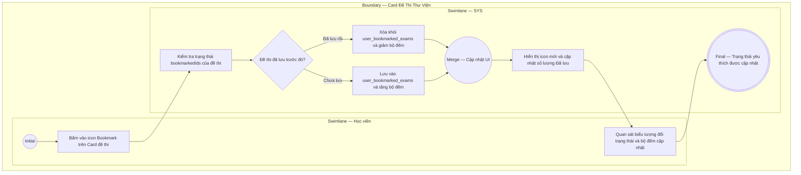

# EPIC02-US02 - Quản Lý Danh Sách Đề Thi Yêu Thích

## Preconditions
- Học viên đang ở giao diện Kho đề thi (`/library`).
- Danh sách đề thi đã được hiển thị trên giao diện.

## Trigger
- Học viên bấm vào biểu tượng Bookmark (cái kẹp sách) ở góc trên bên phải của bất kỳ thẻ đề thi nào (`#exam-bookmark-btn`).
- Màn hình liên quan: Card đề thi trên trang Kho đề thi (`/library`), Thẻ thống kê nhanh trên Header.

## Main Flow

1. Học viên nhìn thấy đề thi cần lưu lại để luyện sau và bấm vào nút icon Bookmark trên Card đề thi.
2. SYS kiểm tra trạng thái hiện tại của đề thi đối với học viên:
   - Nếu chưa lưu: Đánh dấu đề thi thành Đã lưu (`bookmarked = true`), chuyển icon sang trạng thái tô đậm (BookmarkCheck) màu xanh dương/vàng hổ phách.
3. SYS cập nhật số lượng "Đã lưu" tại thanh thống kê nhanh trên đầu trang (`QuickStatsPill`).
4. SYS đồng bộ bản ghi lưu đề vào cơ sở dữ liệu `user_bookmarked_exams`.

- **Business rules / logic:**
  - Nút Bookmark có hành vi bật/tắt (Toggle): Bấm lần đầu là Lưu, bấm lần thứ hai là Bỏ lưu.
  - Sự kiện click nút Bookmark không được kích hoạt sự kiện click thẻ Card (sử dụng `e.stopPropagation()`) để tránh việc người dùng vô tình bị điều hướng vào phòng thi khi chỉ muốn lưu đề.

### Field-level specification — Thẻ Đề Thi (ExamCard)
| Field / control | Loại UI Control | State | Required | Conditional / dynamic | Source / validation |
| :--- | :--- | :--- | :--- | :--- | :--- |
| **Nút Bookmark đề thi** | `Icon Toggle Button`| `USER-INPUT`| `required` | `CONDITIONAL` • Trạng thái `BookmarkCheck` khi đề đã được lưu trong `user_bookmarked_exams`. • Trạng thái `Bookmark` rỗng khi đề chưa được lưu. | Thay đổi màu sắc và icon theo trạng thái lưu |
| **Chỉ số tổng số đề đã lưu** | `Counter Pill` | `READONLY` | `required` | `AUTO-FILL` | Hiển thị chuỗi `"Đã lưu: X"` tăng/giảm theo thao tác của học viên |

## Alternate Flows

### AF-01 — Học viên hủy lưu (Un-bookmark) đề thi
1. Tại bước 2, đề thi đã ở trạng thái đã lưu trước đó.
2. Học viên bấm lại vào icon BookmarkCheck.
3. SYS xóa bản ghi khỏi `user_bookmarked_exams`, chuyển icon về dạng rỗng và giảm số lượng đếm "Đã lưu" trên thanh Header đi 1 đơn vị.

## Exception Flows

- **Lỗi mạng khi lưu đề thi:** Mất kết nối tới server $\rightarrow$ SYS hoàn nguyên lại trạng thái icon trên giao diện và hiển thị thông báo "Không thể cập nhật danh sách yêu thích, vui lòng thử lại".

## Activity Diagram — Swimlane
**Trigger:** Học viên click vào nút Bookmark trên thẻ đề thi.

