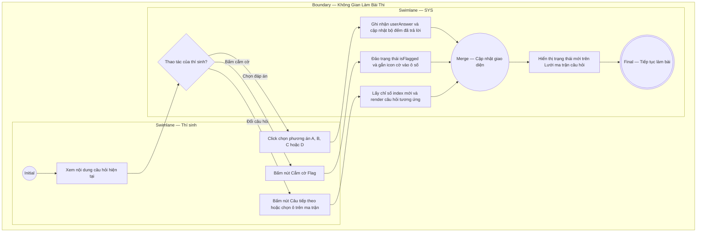

# EPIC03-US01 - Thao Tác Làm Bài Thi & Điều Hướng Câu Hỏi

## Preconditions
- Thí sinh đã tham gia vào phòng thi `/exam/[id]`.
- Danh sách câu hỏi của đề thi (`questions`) đã được tải thành công vào giao diện làm bài.

## Trigger
- Thí sinh click chọn một phương án trả lời (A, B, C, D) hoặc bấm nút cắm cờ Flag / nút điều hướng câu hỏi.
- Màn hình liên quan: Cột phải phòng thi (`QuestionWorkspace`), Lưới bảng câu hỏi (`QuestionMatrix`).

## Main Flow

1. Thí sinh đọc nội dung câu hỏi hiện tại (ví dụ: Câu hỏi số 14).
2. Thí sinh click vào phương án lựa chọn mong muốn (ví dụ: phương án B).
3. SYS ghi nhận `userAnswer = 'B'` vào trạng thái bài làm của thí sinh.
4. SYS cập nhật ô số 14 trên Lưới ma trận câu hỏi sang màu xanh dương (đã trả lời) và tăng bộ đếm "Đã trả lời" trên thanh Header lên 1 đơn vị.
5. Thí sinh bấm nút [ Câu tiếp theo ] (hoặc click trực tiếp vào ô số 15 trên lưới).
6. SYS chuyển đổi nội dung câu hỏi hiển thị sang Câu hỏi số 15 với dạng câu hỏi và phương án tương ứng.

- **Business rules / logic:**
  - Thí sinh có thể thay đổi đáp án đã chọn bất cứ lúc nào trước khi nộp bài; đáp án mới sẽ ghi đè đáp án cũ.
  - Nút cắm cờ xem lại (`isFlagged`): Khi được bật, ô số câu hỏi trên bảng lưới sẽ xuất hiện dấu chấm cờ vàng, giúp thí sinh dễ dàng rà soát lại trước khi nộp bài.
  - Lưới câu hỏi hỗ trợ 4 trạng thái trực quan:
    1. Đang làm (Active): Viền đậm, nền trắng, chữ đậm.
    2. Đã trả lời (Answered): Nền xanh xám/xanh dương, chữ rõ nét.
    3. Đã gắn cờ (Flagged): Có biểu tượng cờ vàng góc ô số.
    4. Chưa làm (Unanswered): Nền xám nhạt.

### Field-level specification — Khung Câu Hỏi & Điều Hướng (QuestionWorkspace)
| Field / control | Loại UI Control | State | Required | Conditional / dynamic | Source / validation |
| :--- | :--- | :--- | :--- | :--- | :--- |
| **Tiêu đề số câu hỏi** | `Heading Text` | `READONLY` | `required` | `DYNAMIC` | Chuỗi `"Câu hỏi X"` (ví dụ: `"Câu hỏi 14"`) |
| **Phân loại dạng bài** | `Badge Text` | `READONLY` | `optional` | `DYNAMIC` | Lấy từ `question_types.name_vi` |
| **Nút Cắm cờ xem lại** | `Toggle Button` | `USER-INPUT` | `optional` | `CONDITIONAL` • Nền vàng chữ hổ phách khi câu hỏi đã được gắn cờ (`isFlagged = true`). • Nền xám chữ nhạt khi chưa gắn cờ. | Đổi trạng thái gắn cờ của câu hỏi |
| **Nội dung câu hỏi tiếng Anh**| `Typography Paragraph`| `READONLY`| `required` | `DYNAMIC` | Lấy từ `questions.prompt` |
| **Dịch nghĩa câu hỏi tiếng Việt**| `Typography Paragraph`| `READONLY`| `optional` | `CONDITIONAL` • Hiện khi câu hỏi có trường `promptVi`. • Ẩn khi `promptVi` rỗng. | Lấy từ `questions.prompt_vi` |
| **Danh sách phương án A, B, C, D**| `Radio Selection Group`| `USER-INPUT`| `required` | `DYNAMIC` | Lấy từ `question_options`, gồm text tiếng Anh và dịch nghĩa |
| **Nút Câu trước** | `Button Action` | `USER-INPUT` | `optional` | `CONDITIONAL` • Disabled khi đang ở câu đầu tiên (`currentIndex === 0`). • Active từ câu thứ 2 trở đi. | Chuyển về câu hỏi liền trước |
| **Nút Câu tiếp theo** | `Button Action` | `USER-INPUT` | `optional` | `CONDITIONAL` • Disabled khi đang ở câu cuối cùng. • Active khi còn câu hỏi phía sau. | Chuyển tới câu hỏi kế tiếp |
| **Bảng lưới ô số câu hỏi** | `Interactive Grid` | `USER-INPUT` | `required` | `DYNAMIC` | Ma trận 1..40 ô số tương tác click nhảy câu tức thì |

## Alternate Flows

### AF-01 — Thí sinh cắm cờ xem lại câu hỏi
1. Thí sinh chưa chắc chắn về đáp án và bấm nút [ Cắm cờ xem lại ].
2. SYS gán `isFlagged = true` cho câu hỏi hiện tại và hiển thị icon cờ trên ô số tương ứng tại lưới câu hỏi.

### AF-02 — Thí sinh click trực tiếp vào ô số trên ma trận câu hỏi
1. Thay vì bấm nút Câu trước / Câu tiếp, thí sinh click trực tiếp vào ô số 17 trên lưới ma trận.
2. SYS lập tức chuyển đổi câu hỏi hiển thị sang câu số 17.

## Exception Flows

- **Dữ liệu câu hỏi bị thiếu tùy chọn:** Dữ liệu câu hỏi bị lỗi cấu hình không có phương án A, B, C, D $\rightarrow$ SYS hiển thị cảnh báo "Câu hỏi đang được cập nhật phương án" và cho phép thí sinh chuyển tiếp sang câu hỏi khác.

## Activity Diagram — Swimlane
**Trigger:** Thí sinh chọn đáp án, gắn cờ hoặc điều hướng câu hỏi trong phòng thi.

