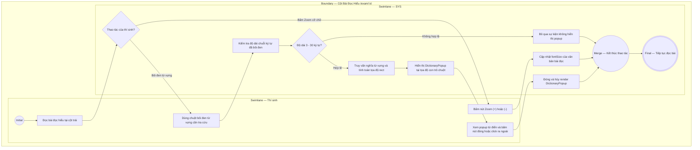

# EPIC03-US02 - Tương Tác Bài Đọc & Tra Từ Điển Ngữ Cảnh

## Preconditions
- Thí sinh đang ở trong phòng thi trực tuyến `/exam/[id]`.
- Cột bên trái hiển thị văn bản bài đọc hiểu (`Passage Workspace`) với các đoạn văn `[Paragraph 1..5]`.

## Trigger
- Thí sinh dùng chuột bôi đen một từ/cụm từ học thuật trong bài đọc hoặc bấm các nút công cụ trên thanh toolbar bài đọc (Zoom cỡ chữ, Bật bút dạ quang).
- Màn hình liên quan: Khung bài đọc hiểu bên trái, Popup tra từ điển ngữ cảnh (`DictionaryPopup`).

## Main Flow

1. Thí sinh đọc bài đọc tại cột bên trái và bắt gặp một từ vựng học thuật chuyên ngành chưa hiểu rõ nghĩa (ví dụ: bôi đen từ `"hydroponic"`).
2. Sự kiện nhả chuột (`mouseUp`) phát hiện chuỗi ký tự được chọn có độ dài hợp lệ (từ 3 đến 30 ký tự).
3. SYS tính toán tọa độ hộp bao văn bản (`getBoundingClientRect()`) và hiển thị Popup tra từ điển ngữ cảnh (`DictionaryPopup`) ngay phía trên cụm từ được bôi đen.
4. Popup hiển thị từ gốc, ký hiệu phiên âm chuẩn quốc tế (`/ˌhaɪ.drəˈpɒn.ɪk/`), nghĩa tiếng Việt chuyên ngành, câu ví dụ thực tế và nút phát âm âm thanh.
5. Thí sinh đọc giải nghĩa xong và click chuột ra ngoài vùng popup (hoặc bấm nút đóng).
6. SYS tự động ẩn popup trả lại không gian đọc thông suốt.

- **Business rules / logic:**
  - Tọa độ hiển thị popup được tính toán tự động chống tràn màn hình (Boundary checking): Tọa độ X bị giới hạn tối đa `window.innerWidth - 200px` để popup không bị cắt xén ở mép màn hình.
  - Hỗ trợ thanh công cụ đọc hiểu (Passage Toolbar):
    - Nút Zoom In `(+)`: Tăng cỡ chữ bài đọc (15px $\rightarrow$ 16px $\rightarrow$ 18px).
    - Nút Zoom Out `(-)`: Giảm cỡ chữ bài đọc (18px $\rightarrow$ 16px $\rightarrow$ 14px).
    - Nút Bút dạ quang (Highlighter Mode): Đổi trạng thái con trỏ và màu nền lựa chọn sang vàng chanh.

### Field-level specification — Khung Bài Đọc & Popup Từ Điển (PassageAndDictPopup)
| Field / control | Loại UI Control | State | Required | Conditional / dynamic | Source / validation |
| :--- | :--- | :--- | :--- | :--- | :--- |
| **Nút Phóng to cỡ chữ (+)** | `Button Action` | `USER-INPUT` | `optional` | `CONDITIONAL` • Disabled khi cỡ chữ đã đạt tối đa 18px. • Active khi cỡ chữ < 18px. | Tăng giá trị `fontSize` thêm 1px |
| **Nút Thu nhỏ cỡ chữ (-)** | `Button Action` | `USER-INPUT` | `optional` | `CONDITIONAL` • Disabled khi cỡ chữ đã ở mức tối thiểu 14px. • Active khi cỡ chữ > 14px. | Giảm giá trị `fontSize` bớt 1px |
| **Nút Bút dạ quang (Highlight)**| `Toggle Button` | `USER-INPUT` | `optional` | `CONDITIONAL` • Nền vàng khi chế độ bôi màu đang bật. • Nền xám khi đang tắt. | Bật/tắt chế độ highlight văn bản |
| **Văn bản các đoạn đọc** | `Passage Content Text`| `READONLY` | `required` | `DYNAMIC` | Lấy từ `passage_paragraphs.content` |
| **Từ gốc tra cứu trên Popup** | `Heading Text` | `READONLY` | `required` | `AUTO-FILL` | Chuỗi ký tự được thí sinh bôi đen |
| **Phiên âm quốc tế IPA** | `Phonetic Text` | `READONLY` | `optional` | `AUTO-FILL` | Lấy từ `vocabulary_terms.phonetic` |
| **Giải nghĩa ngữ cảnh tiếng Việt**| `Paragraph Text` | `READONLY` | `required` | `AUTO-FILL` | Lấy từ `vocabulary_terms.meaning_vi` |
| **Câu ví dụ thực tế** | `Example Block` | `READONLY` | `optional` | `CONDITIONAL` • Hiện khi từ vựng có ví dụ trong bài. • Ẩn khi không có ví dụ. | Lấy từ `vocabulary_terms.example_en` |
| **Nút đóng Popup (X)** | `Icon Button` | `USER-INPUT` | `optional` | `Không` | Đóng popup tra từ tức thì |

## Alternate Flows

### AF-01 — Bôi đen cụm từ không có trong từ điển mẫu
1. Thí sinh bôi đen một cụm từ thông thường không phải thuật ngữ học thuật (ví dụ: `"agricultural innovation"`).
2. SYS hiển thị popup tra cứu với thông điệp: `"Tra cứu ngữ cảnh học thuật cho 'agricultural innovation'"` và cung cấp nghĩa khái quát.

### AF-02 — Thí sinh điều chỉnh cỡ chữ bài đọc
1. Thí sinh bấm liên tiếp 2 lần vào nút [+] trên thanh công cụ bài đọc.
2. SYS nâng cỡ font chữ từ 15px lên 18px, văn bản các đoạn dãn rộng giúp dễ đọc hơn mà không ảnh hưởng tới cột câu hỏi bên phải.

## Exception Flows

- **Vùng chọn văn bản quá ngắn hoặc quá dài:** Thí sinh vô tình bôi đen 1 chữ cái hoặc toàn bộ trang $\rightarrow$ SYS bỏ qua sự kiện và không hiển thị popup tra từ để tránh làm phiền thí sinh.

## Activity Diagram — Swimlane
**Trigger:** Thí sinh bôi đen từ vựng trong bài đọc hoặc bấm công cụ zoom/highlight.

