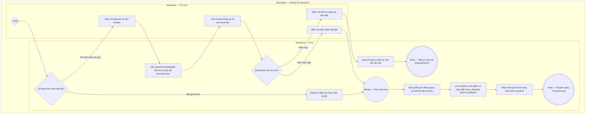

# EPIC03-US03 - Quản Lý Thời Gian Thi & Nộp Bài Thi

## Preconditions
- Thí sinh đang tham gia phòng thi trực tuyến `/exam/[id]`.
- Đồng hồ đếm ngược đang kích hoạt tính giờ bài thi.

## Trigger
- Thí sinh bấm nút [ Nộp bài thi ] tại Header phòng thi hoặc thời gian làm bài đếm ngược về 00:00.
- Màn hình liên quan: Header phòng thi (`ExamHeaderBar`), Modal xác nhận nộp bài (`SubmitConfirmModal`).

## Main Flow

1. Thí sinh hoàn thành các câu hỏi trong bài và bấm nút [ Nộp bài thi ] tại góc phải thanh Header.
2. SYS hiển thị Modal xác nhận nộp bài (`SubmitConfirmModal`) với các thông số thống kê:
   - Số câu đã trả lời / tổng số câu (ví dụ: `14/17 câu`).
   - Cảnh báo số câu còn bỏ trống nếu có (ví dụ: "Bạn còn 3 câu chưa trả lời").
   - Thời gian làm bài còn lại (ví dụ: "Còn 48 phút 13 giây").
3. Thí sinh bấm nút [ Xác nhận nộp bài ] trong modal.
4. SYS dừng đồng hồ đếm ngược, lưu toàn bộ đáp án vào `exam_attempt_answers`, tính toán điểm số thô, cập nhật trạng thái phiên thi sang `completed` và điều hướng thí sinh sang trang Báo cáo kết quả (`/result/[id]`).

- **Business rules / logic:**
  - Hết giờ tự động nộp: Khi `timeLeftSeconds === 0`, hệ thống tự động khóa tương tác làm bài, hiển thị thông báo "Đã hết thời gian làm bài" và tự động nộp bài mà không cần thí sinh bấm xác nhận.
  - Tính năng ẩn/tạm dừng đồng hồ:
    - Nút Icon Con mắt: Ẩn số phút giây (hiển thị `--:--`) để giảm bớt căng thẳng tâm lý cho thí sinh.
    - Nút Icon Pause/Play: Cho phép tạm dừng đồng hồ trong chế độ luyện tập tự do.
  - Cảnh báo thời gian nguy hiểm: Khi thời gian còn lại $< 5$ phút ($< 300$ giây), khung đồng hồ tự động chuyển sang màu đỏ hồng (`bg-rose-50 text-rose-700 border-rose-300`) để cảnh báo trực quan.

### Field-level specification — Modal Xác Nhận Nộp Bài (SubmitConfirmModal)
| Field / control | Loại UI Control | State | Required | Conditional / dynamic | Source / validation |
| :--- | :--- | :--- | :--- | :--- | :--- |
| **Tiêu đề cảnh báo modal** | `Heading Text` | `READONLY` | `required` | `Không` | Chuỗi `"Xác nhận nộp bài thi"` |
| **Thông số câu đã làm** | `Text Label` | `READONLY` | `required` | `AUTO-FILL` | Hiển thị chuỗi `"Đã hoàn thành X/Y câu hỏi"` |
| **Cảnh báo câu chưa trả lời**| `Alert Banner` | `READONLY` | `optional` | `CONDITIONAL` • Hiện khi số câu đã làm < tổng số câu (`answeredCount < totalQuestions`). • Ẩn khi đã trả lời 100% các câu hỏi. | Hiển thị hộp cảnh báo màu vàng kèm số câu còn thiếu |
| **Thông số thời gian còn lại** | `Text Label` | `READONLY` | `required` | `AUTO-FILL` | Lấy từ giá trị đếm lùi `timeLeftSeconds` |

## Alternate Flows

### AF-01 — Thí sinh bấm Hủy trong modal nộp bài
1. Tại bước 2, thí sinh nhận thấy còn câu chưa làm và bấm nút [ Tiếp tục làm bài / Hủy ].
2. SYS đóng modal xác nhận và đưa thí sinh trở lại phòng thi để tiếp tục hoàn thiện các câu còn thiếu.

### AF-02 — Tự động nộp bài khi đồng hồ về 00:00
1. Đồng hồ đếm lùi về mốc `00:00`.
2. SYS kích hoạt hàm `handleSubmitExam()`, đóng mọi modal đang mở và tự động chuyển hướng sang trang kết quả.

## Exception Flows

- **Lỗi mạng khi gửi bài thi lên máy chủ:** Kết nối mạng bị mất khi bấm xác nhận nộp $\rightarrow$ SYS lưu bài thi vào bộ nhớ đệm an toàn của trình duyệt (IndexedDB/LocalStorage), giữ nguyên trạng thái modal và hiển thị nút "Thử gửi lại bài thi" để đảm bảo không mất bài của thí sinh.

## Activity Diagram — Swimlane
**Trigger:** Thí sinh bấm nút Nộp bài thi hoặc hệ thống đếm ngược về 00:00.

