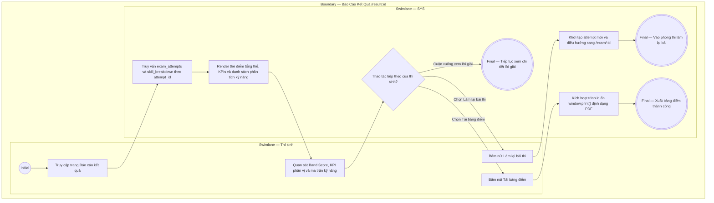

# EPIC04-US01 - Xem Tổng Quan Điểm Số & Phân Tích Kỹ Năng

## Preconditions
- Thí sinh đã nộp bài thi thành công hoặc truy cập vào trang kết quả của bài thi đã hoàn thành (`status = 'completed'`).
- Hệ thống đã tính toán xong điểm số, tỷ lệ phần trăm và các chỉ số phân vị bách phân trong bảng `exam_attempts`.

## Trigger
- Thí sinh được điều hướng tự động sang `/result/[id]` sau khi nộp bài hoặc bấm vào mục "Kết quả" trên thanh Header Navbar.
- Màn hình liên quan: Giao diện Báo cáo kết quả bài thi (`/result/[id]`), Thẻ điểm tổng thể (`OverallScoreCard`), Khối Phân tích năng lực theo dạng bài (`SkillBreakdownSection`).

## Main Flow

1. Thí sinh truy cập trang Báo cáo kết quả bài thi (`/result/[id]`).
2. SYS truy vấn dữ liệu từ bảng `exam_attempts` và `exam_attempt_skill_breakdown`.
3. SYS hiển thị Thẻ điểm tổng thể (Overall Score Card) gồm:
   - Điểm số Band Score quy chuẩn to nổi bật font Monospace (ví dụ: `7.5 / 9.0 Band`).
   - Thông điệp đánh giá so với mục tiêu học tập (ví dụ: `"Xuất sắc! Vượt mục tiêu Band 7.0 của bạn"`).
   - Tỷ lệ chính xác (ví dụ: `80% - 32/40 câu đúng`).
   - Thứ hạng phân vị bách phân (ví dụ: `Top 14% - Cao hơn 86% thí sinh`).
   - Thời gian làm bài thực tế (ví dụ: `52m / Giới hạn: 60 phút`) và tốc độ làm bài trung bình (`1.2 m/câu`).
4. SYS hiển thị Ma trận phân tích năng lực theo từng dạng bài (Skill Breakdown):
   - Multiple Choice: Tỷ lệ đúng 100%, Đánh giá Xuất sắc.
   - Matching Headings: Tỷ lệ đúng 100%, Đánh giá Xuất sắc.
   - Sentence Completion: Tỷ lệ đúng 100%, Đánh giá Xuất sắc.
   - True / False / Not Given: Tỷ lệ đúng 0%, Đánh giá Cần cải thiện (viền hồng đỏ cảnh báo).
5. Thí sinh quan sát các chỉ số để nắm bắt điểm mạnh và dạng bài yếu nhất của bản thân.

- **Business rules / logic:**
  - Quy đổi Band Score: Dựa trên ma trận chấm điểm chuẩn quốc tế (ví dụ: thang điểm Cambridge 40 câu: 30-32 câu đúng = Band 7.5; 33-34 câu đúng = Band 8.0).
  - Điểm bách phân (Percentile Rank) và Tỷ lệ vượt qua (`beatenPercentage`): Được tính toán bằng cách so sánh điểm số của thí sinh với phân phối điểm chuẩn của toàn bộ `total_participants_benchmark` thí sinh đã tham gia đề thi này trong hệ thống.
  - Cảnh báo dạng bài yếu (`isWeak`): Bất kỳ dạng bài nào có tỷ lệ chính xác $< 70\%$ sẽ tự động được gắn cờ `isWeak = true`, hiển thị màu nền cảnh báo `bg-rose-50/50 border-rose-200` và text đỏ.

### Field-level specification — Màn hình Báo Cáo Kết Quả (ResultOverviewScreen)
| Field / control | Loại UI Control | State | Required | Conditional / dynamic | Source / validation |
| :--- | :--- | :--- | :--- | :--- | :--- |
| **Tiêu đề đề thi** | `Heading Text` | `READONLY` | `required` | `DYNAMIC` | Lấy từ `exams.title` |
| **Thời gian làm bài thực tế** | `Subtitle Text` | `READONLY` | `required` | `AUTO-FILL` | Định dạng `"Thời gian làm bài: X phút Y giây"` |
| **Nút Làm lại bài thi** | `Button Action` | `USER-INPUT` | `required` | `Không` | Điều hướng quay trở lại phòng thi `/exam/[id]` |
| **Nút Tải bảng điểm** | `Button Action` | `USER-INPUT` | `optional` | `Không` | Kích hoạt chức năng in hoặc lưu file PDF `window.print()` |
| **Khối Band Score quy chuẩn** | `Monospace Metric` | `READONLY` | `required` | `AUTO-FILL` | Lấy từ `exam_attempts.band_score` (ví dụ: `7.5`) |
| **Thông điệp so với mục tiêu** | `Alert Message` | `READONLY` | `optional` | `DYNAMIC` | Lấy từ `exam_attempts.target_comparison_message` |
| **Tỷ lệ chính xác %** | `Metric Card` | `READONLY` | `required` | `AUTO-FILL` | Lấy từ `exam_attempts.accuracy_percentage` kèm số câu đúng/tổng |
| **Điểm bách phân Top %** | `Metric Card` | `READONLY` | `required` | `AUTO-FILL` | Lấy từ `exam_attempts.percentile_rank` kèm % vượt qua |
| **Tốc độ làm bài** | `Metric Card` | `READONLY` | `required` | `AUTO-FILL` | Tính toán số phút trung bình trên 1 câu hỏi |
| **Thẻ phân tích dạng bài** | `Grid Cards` | `READONLY` | `required` | `DYNAMIC` | Lấy từ `exam_attempt_skill_breakdown`, gồm tên dạng, tỷ lệ, progress bar, nhận xét |

## Alternate Flows

### AF-01 — Thí sinh bấm Làm lại bài thi
1. Thí sinh bấm nút [ Làm lại bài thi ] trên thanh Header của trang kết quả.
2. SYS khởi tạo một phiên thi mới trong `exam_attempts` và điều hướng thí sinh quay lại phòng thi `/exam/[id]`.

### AF-02 — Thí sinh bấm Tải bảng điểm
1. Thí sinh bấm nút [ Tải bảng điểm ].
2. SYS kích hoạt hộp thoại in của trình duyệt (`window.print()`) với CSS tối ưu hóa trang in (ẩn các nút thừa, giữ nguyên bảng điểm và nhận xét).

## Exception Flows

- **Không tìm thấy kết quả bài thi:** ID phiên thi không tồn tại trong `exam_attempts` $\rightarrow$ SYS hiển thị thông báo "Không tìm thấy dữ liệu kết quả bài thi này" và nút chuyển về Trang chủ.

## Activity Diagram — Swimlane
**Trigger:** Thí sinh truy cập màn hình báo cáo kết quả sau khi nộp bài.

