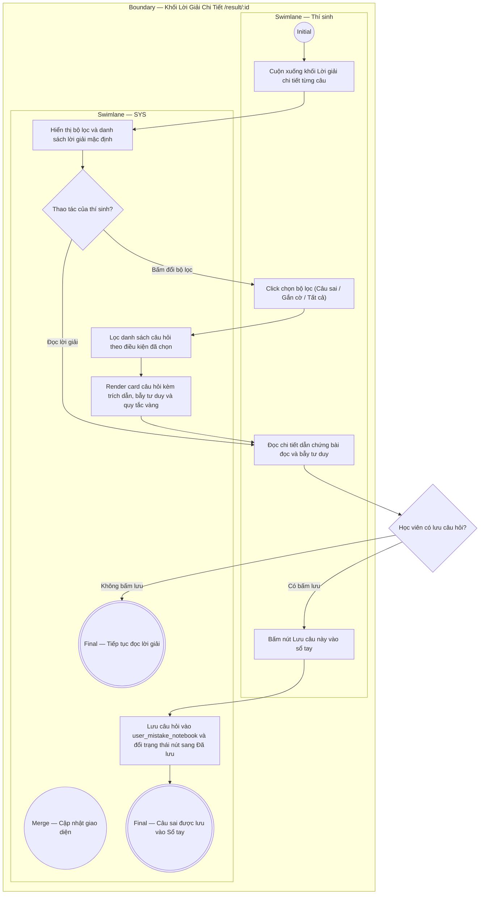

# EPIC04-US02 - Tra Cứu Chi Tiết Lời Giải & Bẫy Đề Thi

## Preconditions
- Thí sinh đang xem màn hình Báo cáo kết quả bài thi (`/result/[id]`).
- Ngân hàng lời giải sư phạm (`question_explanations`) cho toàn bộ câu hỏi trong đề đã có sẵn trong cơ sở dữ liệu.

## Trigger
- Thí sinh cuộn xuống phần "Chi tiết lời giải từng câu hỏi" và bấm chọn các bộ lọc câu hỏi (Tất cả, Câu sai, Đã gắn cờ) hoặc bấm nút lưu câu sai vào sổ tay.
- Màn hình liên quan: Khối Lời giải chi tiết trên trang Kết quả (`QuestionReviewList`).

## Main Flow

1. Thí sinh cuộn xuống khối Chi tiết lời giải từng câu hỏi.
2. SYS hiển thị bộ 3 nút lọc: [ Tất cả (4) ], [ Câu sai (1) ], [ Đã gắn cờ (1) ].
3. Thí sinh bấm vào nút [ Câu sai (1) ].
4. SYS lọc danh sách chỉ hiển thị những câu hỏi mà `userAnswer !== correctAnswer` (ví dụ: Câu hỏi số 15).
5. SYS hiển thị card chi tiết câu hỏi gồm:
   - Huy hiệu "Câu 15: Sai" viền đỏ hồng.
   - Nội dung câu hỏi và dịch nghĩa.
   - So sánh trực quan: "Câu trả lời của bạn: FALSE" vs "Đáp án chính xác: NOT GIVEN".
   - Vị trí dẫn chứng trong bài đọc (`evidenceLocation`: "Reading Passage 2 · Paragraph 4, Line 2") kèm đoạn trích nguyên văn dẫn chứng (`evidenceQuote`).
   - Khối phân tích Bẫy đề thi & Lỗi tư duy thường gặp (`mindsetTrap`).
   - Hộp Quy tắc vàng làm bài chuẩn khảo thí (`goldenRule`).
6. Thí sinh bấm nút [ Lưu câu này vào sổ tay ] trên đầu card.
7. SYS lưu câu hỏi vào bảng `user_mistake_notebook`, chuyển icon sang trạng thái `BookmarkCheck` kèm thông báo "Đã lưu vào sổ tay lỗi sai".

- **Business rules / logic:**
  - Bộ lọc hỗ trợ 3 trạng thái độc quyền:
    - `all`: Hiển thị toàn bộ câu hỏi trong bài.
    - `wrong`: Chỉ hiển thị các câu hỏi có đáp án sai.
    - `flagged`: Chỉ hiển thị các câu hỏi được thí sinh cắm cờ lúc thi.
  - Phân tích sư phạm chuyên sâu: Mỗi câu sai bắt buộc phải hiển thị ít nhất một trong ba khối chẩn đoán:
    - Bẫy tư duy (Mindset Trap): Ngăn chặn việc tự suy đoán thông tin ngoài bài.
    - Bẫy từ vựng (Vocabulary / Paraphrase Trap): Chỉ rõ các từ đồng nghĩa được dùng để đánh lừa.
    - Quy tắc vàng (Golden Rule): Phương pháp chuẩn của giám khảo quốc tế.

### Field-level specification — Khung Chi Tiết Lời Giải (QuestionReviewSection)
| Field / control | Loại UI Control | State | Required | Conditional / dynamic | Source / validation |
| :--- | :--- | :--- | :--- | :--- | :--- |
| **Nút lọc Tất cả câu** | `Filter Button` | `USER-INPUT` | `required` | `Không` | Hiển thị toàn bộ câu hỏi kèm số lượng tổng |
| **Nút lọc Chỉ câu sai** | `Filter Button` | `USER-INPUT` | `optional` | `DYNAMIC` | Lọc các câu làm sai kèm số lượng câu sai |
| **Nút lọc Câu gắn cờ** | `Filter Button` | `USER-INPUT` | `optional` | `DYNAMIC` | Lọc các câu đã cắm cờ kèm số lượng gắn cờ |
| **Huy hiệu Đúng / Sai** | `Status Badge` | `READONLY` | `required` | `DYNAMIC` | Màu xanh lá nếu đúng, màu đỏ hồng nếu sai |
| **Nút Lưu vào sổ tay** | `Button Action` | `USER-INPUT` | `optional` | `CONDITIONAL` • Text "Đã lưu vào sổ tay" khi câu đã có trong notebook. • Text "Lưu câu này vào sổ tay" khi chưa lưu. | Lưu hoặc hủy lưu câu hỏi trong `user_mistake_notebook` |
| **Đáp án của thí sinh** | `Answer Display Box`| `READONLY` | `required` | `DYNAMIC` | Hiển thị phương án thí sinh đã chọn |
| **Đáp án chính xác** | `Answer Display Box`| `READONLY` | `required` | `DYNAMIC` | Hiển thị đáp án chính xác tuyệt đối |
| **Khối trích dẫn bài đọc** | `Blockquote Citation`| `READONLY` | `optional` | `CONDITIONAL` • Hiện khi câu hỏi có dẫn chứng trong bài. • Ẩn khi câu không gắn bài đọc. | Lấy từ `evidence_location` và `evidence_quote` |
| **Khối Bẫy tư duy Mindset**| `Diagnostic Box` | `READONLY` | `optional` | `CONDITIONAL` • Hiện khi có nội dung `mindset_trap`. • Ẩn khi trường rỗng. | Lấy từ `question_explanations.mindset_trap` |
| **Khối Bẫy từ vựng Paraphrase**| `Diagnostic Box`| `READONLY` | `optional` | `CONDITIONAL` • Hiện khi có nội dung `vocabulary_trap`. • Ẩn khi trường rỗng. | Lấy từ `question_explanations.vocabulary_trap` |
| **Khối Quy tắc vàng** | `Golden Rule Box`| `READONLY` | `optional` | `CONDITIONAL` • Hiện khi có nội dung `golden_rule`. • Ẩn khi trường rỗng. | Hộp viền hổ phách chứa bí kíp khảo thí |

## Alternate Flows

### AF-01 — Thí sinh lọc theo câu hỏi đã gắn cờ
1. Tại bước 3, thí sinh bấm chọn tab [ Đã gắn cờ ].
2. SYS lọc danh sách chỉ hiển thị các câu hỏi mà thí sinh đã cắm cờ `isFlagged === true` trong lúc làm bài thi.

### AF-02 — Thí sinh mở trực tiếp Sổ tay lỗi sai từ chân trang kết quả
1. Cuộn xuống cuối trang, thí sinh bấm nút [ Mở sổ tay lỗi sai ].
2. SYS kích hoạt mở `MistakeNotebookModal` hiển thị danh sách toàn bộ lỗi sai đã tích lũy.

## Exception Flows

- **Câu hỏi không có dữ liệu lời giải chi tiết:** Lời giải chưa được biên soạn xong $\rightarrow$ SYS hiển thị thông điệp "Lời giải chi tiết cho câu hỏi này đang được đội ngũ chuyên môn cập nhật".

## Activity Diagram — Swimlane
**Trigger:** Thí sinh bấm chọn bộ lọc lời giải hoặc bấm lưu câu hỏi vào sổ tay lỗi sai.

