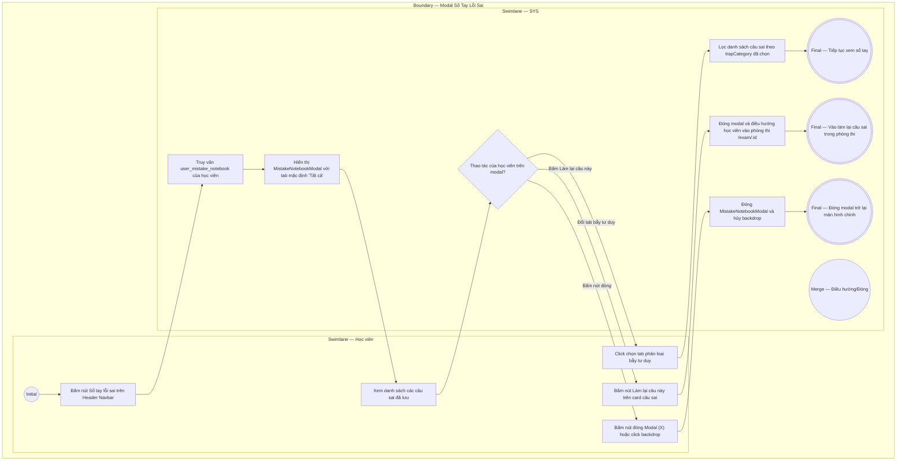

# EPIC05-US01 - Quản Lý & Ôn Tập Sổ Tay Lỗi Sai Theo Bẫy Tư Duy

## Preconditions
- Học viên đã đăng nhập và tích lũy ít nhất một câu hỏi làm sai trong bảng `user_mistake_notebook`.
- Danh mục phân loại bẫy đề thi (`mistake_trap_types`: Mindset, Vocab, Negation...) đã được định nghĩa trong hệ thống.

## Trigger
- Học viên bấm vào nút [ Sổ tay lỗi sai (12) ] trên thanh Top Utility Bar của Header Navbar hoặc nút [ Mở sổ tay lỗi sai ] tại chân trang Kết quả.
- Màn hình liên quan: Modal Sổ tay ghi chú lỗi sai & Bẫy tư duy (`MistakeNotebookModal`).

## Main Flow

1. Học viên bấm vào nút [ Sổ tay lỗi sai ] trên thanh Header Navbar.
2. SYS hiển thị Modal Sổ tay lỗi sai (`MistakeNotebookModal`) với nền làm mờ toàn màn hình.
3. SYS tải danh sách toàn bộ câu sai đã lưu của học viên, mặc định chọn tab [ Tất cả lỗi sai (3) ].
4. Học viên click chuyển sang tab [ Bẫy tư duy / Not Given ].
5. SYS lọc danh sách chỉ hiển thị các câu sai thuộc nhóm bẫy tư duy (ví dụ: Câu hỏi số 15 của đề IELTS Cam 18 Test 3).
6. Học viên xem xét chi tiết:
   - Tên đề thi, phần thi và dạng câu hỏi.
   - So sánh đáp án đã chọn sai vs Đáp án đúng.
   - Phân tích bẫy tư duy chi tiết: Chỉ rõ việc bài văn chỉ nói về các nước công nghiệp Bắc bán cầu nhưng câu hỏi lại bẫy về Đông Nam Á.
   - Quy tắc vàng cần ghi nhớ để không tái phạm.
7. Học viên bấm nút [ Làm lại câu này ] (Retake Question).
8. SYS điều hướng học viên vào phòng thi tại vị trí câu hỏi đó để thực hành làm lại độc lập.

- **Business rules / logic:**
  - Modal hỗ trợ 4 tab phân loại bẫy tư duy:
    1. `all`: Toàn bộ các câu sai đã lưu.
    2. `mindset`: Bẫy suy luận chủ quan / Bẫy Not Given (suy diễn ngoài bài).
    3. `vocab`: Bẫy từ vựng & Paraphrasing (hiểu sai nghĩa từ đồng nghĩa).
    4. `negation`: Bẫy ngữ pháp phủ định & Cấu trúc đảo ngữ (Inversion traps).
  - Trạng thái đã khắc phục (`is_resolved`): Nếu học viên làm lại câu hỏi và chọn đúng, câu hỏi được đánh dấu `is_resolved = true` kèm huy hiệu xanh "Đã sửa thành công".

### Field-level specification — Modal Sổ Tay Lỗi Sai (MistakeNotebookModal)
| Field / control | Loại UI Control | State | Required | Conditional / dynamic | Source / validation |
| :--- | :--- | :--- | :--- | :--- | :--- |
| **Tiêu đề Modal** | `Heading Text` | `READONLY` | `required` | `Không` | Chuỗi `"Sổ tay ghi chú lỗi sai & Bẫy tư duy"` |
| **Tab Tất cả lỗi sai** | `Tab Button` | `USER-INPUT` | `required` | `DYNAMIC` | Hiển thị tổng số câu sai đã tích lũy |
| **Tab Bẫy tư duy / Not Given**| `Tab Button` | `USER-INPUT` | `optional` | `DYNAMIC` | Lọc các câu thuộc nhóm `mindset` |
| **Tab Bẫy từ vựng & Paraphrase**| `Tab Button`| `USER-INPUT`| `optional` | `DYNAMIC` | Lọc các câu thuộc nhóm `vocab` |
| **Tab Bẫy ngữ pháp đảo ngữ** | `Tab Button` | `USER-INPUT` | `optional` | `DYNAMIC` | Lọc các câu thuộc nhóm `negation` |
| **Nút Làm lại câu này** | `Button Action` | `USER-INPUT` | `optional` | `CONDITIONAL` • Hiện khi câu hỏi hỗ trợ tính năng làm lại (`retakeAvailable = true`). • Ẩn khi câu đã sửa xong hoặc không hỗ trợ retake. | Điều hướng tới phòng thi để làm lại câu hỏi |

## Alternate Flows

### AF-01 — Danh sách câu sai theo tab bị rỗng
1. Học viên chuyển sang tab [ Bẫy ngữ pháp đảo ngữ ] nhưng chưa lưu câu nào thuộc dạng này.
2. SYS hiển thị thông báo rỗng: "Không có câu hỏi nào thuộc nhóm bẫy này trong sổ tay của bạn".

### AF-02 — Học viên đóng modal
1. Học viên bấm nút [ X ] hoặc click chuột vào vùng nền mờ backdrop.
2. SYS đóng modal và giữ nguyên giao diện trang hiện tại.

## Exception Flows

- **Lỗi mạng khi tải sổ tay lỗi sai:** Mất kết nối API $\rightarrow$ SYS hiển thị thông báo lỗi "Không thể tải danh sách câu sai, vui lòng thử lại sau" và nút tải lại.

## Activity Diagram — Swimlane
**Trigger:** Học viên bấm mở Sổ tay lỗi sai từ Navbar hoặc Trang kết quả.

