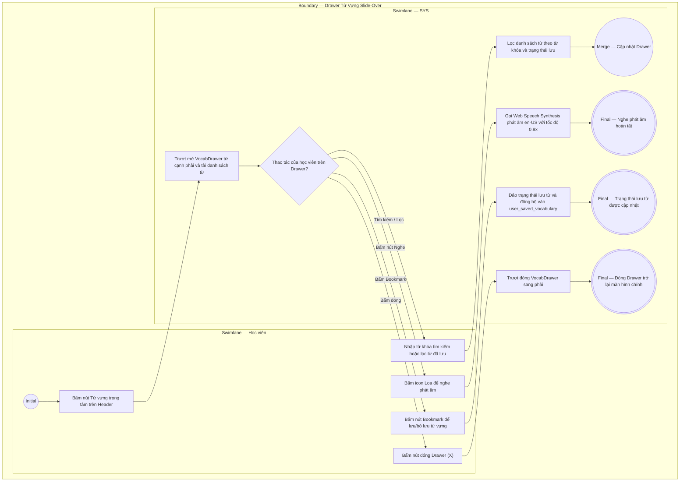

# EPIC05-US02 - Tra Cứu, Phát Âm & Lưu Trữ Từ Vựng Học Thuật

## Preconditions
- Học viên đang ở bất kỳ trang nào trên nền tảng EduTest Pro có hiển thị thanh Header Navbar.
- Ngân hàng từ vựng học thuật (`vocabulary_terms`) đã được liên kết với đề thi hoặc các chứng chỉ chuyên ngành.

## Trigger
- Học viên bấm vào nút [ Từ vựng trọng tâm (<Mục tiêu>) ] trên thanh Top Utility Bar hoặc nút [ Xem từ vựng bài đọc ] tại chân trang Kết quả.
- Màn hình liên quan: Khung trượt từ vựng bên phải màn hình (`VocabDrawer`).

## Main Flow

1. Học viên bấm vào nút [ Từ vựng trọng tâm ] trên thanh Navbar.
2. SYS kích hoạt hiệu ứng trượt Slide-Over mở Drawer từ vựng bên phải màn hình (`VocabDrawer`).
3. SYS tải danh sách từ vựng học thuật band 7.0 - 8.5+ tương ứng với mục tiêu chứng chỉ hiện tại.
4. Học viên nhập từ khóa vào ô tìm kiếm (ví dụ: gõ `"drastically"` hoặc `"mạnh mẽ"`).
5. SYS lọc tức thì danh sách từ vựng hiển thị các mục từ có chứa chuỗi tìm kiếm trong từ gốc tiếng Anh hoặc trong phần giải nghĩa tiếng Việt.
6. Học viên bấm vào biểu tượng Loa phát âm cạnh từ vựng.
7. SYS sử dụng Web Speech Synthesis API phát âm thanh chuẩn giọng bản ngữ (`en-US`, tốc độ 0.9x) và nhấp nháy hiệu ứng sóng âm trên icon loa.
8. Học viên bấm nút Bookmark cạnh từ để lưu vào sổ từ vựng cá nhân.
9. SYS lưu bản ghi vào `user_saved_vocabulary` và cập nhật biểu tượng sang màu vàng hổ phách `BookmarkCheck`.

- **Business rules / logic:**
  - Phát âm âm thanh bản ngữ: Tích hợp trực tiếp trình phát âm chuẩn của trình duyệt (`window.speechSynthesis`), tốc độ điều chỉnh 0.9x để người học nghe rõ từng âm tiết và trọng âm.
  - Bộ lọc "Chỉ từ đã lưu": Cho phép người học chuyển đổi chế độ xem toàn bộ từ vựng sang chỉ xem những từ mình đã bookmark để phục vụ ôn tập nhanh trước kỳ thi.
  - Tìm kiếm song ngữ: Ô input tìm kiếm hỗ trợ tra cứu cả bằng từ gốc tiếng Anh (Prefix/Infix search) lẫn từ khóa trong nghĩa tiếng Việt.

### Field-level specification — Drawer Tra Cứu Từ Vựng (VocabDrawerScreen)
| Field / control | Loại UI Control | State | Required | Conditional / dynamic | Source / validation |
| :--- | :--- | :--- | :--- | :--- | :--- |
| **Tiêu đề Drawer** | `Heading Text` | `READONLY` | `required` | `Không` | Chuỗi `"Từ Vựng Trọng Tâm Bài Đọc"` |
| **Ô tìm kiếm từ vựng** | `Text Input` | `USER-INPUT` | `optional` | `TRIGGER` | Tìm kiếm theo từ gốc tiếng Anh hoặc nghĩa tiếng Việt |
| **Nút Xóa tìm kiếm** | `Icon Button` | `USER-INPUT` | `optional` | `CONDITIONAL` • Hiện khi ô tìm kiếm có ký tự. • Ẩn khi ô rỗng. | Xóa trắng nội dung tìm kiếm |
| **Nút lọc Chỉ từ đã lưu** | `Filter Toggle` | `USER-INPUT` | `optional` | `CONDITIONAL` • Nền vàng chữ đậm khi đang bật lọc từ đã lưu. • Nền xám khi đang xem tất cả. | Bật/tắt chế độ chỉ hiển thị từ vựng đã bookmark |
| **Từ gốc tiếng Anh** | `Typography Word` | `READONLY` | `required` | `DYNAMIC` | Lấy từ `vocabulary_terms.word` |
| **Phiên âm quốc tế IPA** | `Phonetic Monospace`| `READONLY` | `required` | `DYNAMIC` | Lấy từ `vocabulary_terms.phonetic` |
| **Từ loại** | `Badge Tag` | `READONLY` | `required` | `DYNAMIC` | Lấy từ `vocabulary_terms.part_of_speech` |
| **Nút Phát âm âm thanh** | `Icon Button` | `USER-INPUT` | `optional` | `DYNAMIC` | Phát âm chuẩn qua Web Speech Synthesis API |
| **Nút Lưu từ vựng** | `Icon Toggle` | `USER-INPUT` | `optional` | `CONDITIONAL` • Biểu tượng `BookmarkCheck` vàng khi đã lưu. • Biểu tượng `Bookmark` xám khi chưa lưu. | Thêm/xóa từ vựng trong `user_saved_vocabulary` |
| **Giải nghĩa tiếng Việt** | `Paragraph Text` | `READONLY` | `required` | `DYNAMIC` | Lấy từ `vocabulary_terms.meaning_vi` |
| **Câu ví dụ thực tế** | `Example Block` | `READONLY` | `optional` | `DYNAMIC` | Trích đoạn nguyên văn câu chứa từ trong bài đọc |
| **Cụm từ Collocation** | `Text Label` | `READONLY` | `optional` | `CONDITIONAL` • Hiện khi từ vựng có trường `collocation`. • Ẩn khi trường rỗng. | Gợi ý cụm từ kết hợp chuẩn bản ngữ |

## Alternate Flows

### AF-01 — Học viên lọc chỉ xem các từ đã lưu
1. Học viên bấm vào nút [ Chỉ từ đã lưu (5) ].
2. SYS lọc danh sách chỉ giữ lại các mục từ có `isSaved === true`.

### AF-02 — Học viên đóng Drawer
1. Học viên bấm nút [ X ] hoặc click chuột vào vùng nền mờ bên ngoài Drawer.
2. SYS trượt Drawer sang phải và ẩn giao diện.

## Exception Flows

- **Trình duyệt không hỗ trợ Speech Synthesis API:** Thiết bị cũ không hỗ trợ Web Speech $\rightarrow$ SYS tự động chuyển sang phát file âm thanh audio tĩnh từ CDN (`audio_url`).

## Activity Diagram — Swimlane
**Trigger:** Học viên bấm mở Drawer từ vựng trên Navbar hoặc bấm phát âm/lưu từ.

