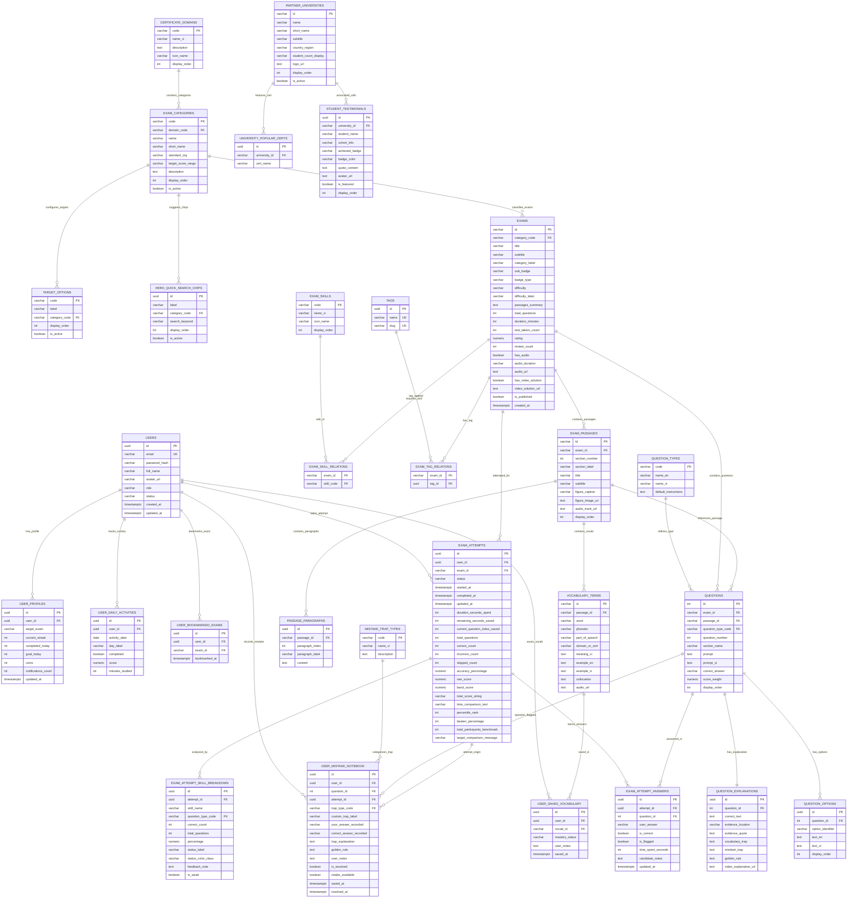

# ĐẶC TẢ CƠ SỞ DỮ LIỆU TOÀN DIỆN & SƠ ĐỒ ERD (ENTITY RELATIONSHIP DIAGRAM)
## HỆ THỐNG LUYỆN THI CHỨNG CHỈ TIÊU CHUẨN QUỐC TẾ — EDUTEST PRO (CERTPREP)
### *Thiết kế chuẩn hóa dựa trên Đặc tả Phân hệ chức năng (5 Epics) & 12 User Stories chi tiết*

> **Phiên bản:** 2.0 (Chuẩn hóa toàn diện theo Đặc tả Chức năng Epics & User Stories)  
> **Hệ quản trị CSDL đề xuất:** PostgreSQL 16+ (hỗ trợ JSONB, GIN Full-Text Index, UUID v4)  
> **Nguyên tắc cốt lõi:** 100% dữ liệu hiển thị động, trạng thái tương tác, tiến độ bài thi và phân tích sư phạm trong toàn bộ 12 User Stories đều được lưu trữ và truy xuất từ CSDL có cấu trúc.

---

## MỤC LỤC
1. [Kiến trúc CSDL & Ánh xạ từ 5 Epics / 12 User Stories](#1-kiến-trúc-csdl--ánh-xạ-từ-5-epics--12-user-stories)
2. [Sơ đồ Thực thể - Quan hệ Mermaid (Entity Relationship Diagram)](#2-sơ-đồ-thực-thể---quan-hệ-mermaid-erd)
3. [Từ điển dữ liệu chi tiết từng bảng (Data Dictionary)](#3-từ-điển-dữ-liệu-chi-tiết-từng-bảng-data-dictionary)
   - [3.1. Phân hệ 1: Tài khoản, Hồ sơ & Gamification](#31-phân-hệ-1-tài-khoản-hồ-sơ--gamification) *(Ánh xạ EPIC01-US01, EPIC01-US02)*
   - [3.2. Phân hệ 2: Khối khảo thí, Chứng chỉ & Cấu hình mục tiêu](#32-phân-hệ-2-khối-khảo-thí-chứng-chỉ--cấu-hình-mục-tiêu) *(Ánh xạ EPIC01-US02, EPIC01-US03, EPIC02-US01)*
   - [3.3. Phân hệ 3: Ngân hàng đề thi, Tags & Yêu thích](#33-phân-hệ-3-ngân-hàng-đề-thi-tags--yêu-thích) *(Ánh xạ EPIC01-US03, EPIC02-US01, EPIC02-US02)*
   - [3.4. Phân hệ 4: Bài đọc hiểu đa đoạn & Media khảo thí](#34-phân-hệ-4-bài-đọc-hiểu-đa-đoạn--media-khảo-thí) *(Ánh xạ EPIC03-US02)*
   - [3.5. Phân hệ 5: Ngân hàng câu hỏi & Lời giải chuẩn sư phạm](#35-phân-hệ-5-ngân-hàng-câu-hỏi--lời-giải-chuẩn-sư-phạm) *(Ánh xạ EPIC03-US01, EPIC04-US02)*
   - [3.6. Phân hệ 6: Phiên làm bài, Bài nộp & Thống kê bách phân](#36-phân-hệ-6-phiên-làm-bài-bài-nộp--thống-kê-bách-phân) *(Ánh xạ EPIC01-US01, EPIC03-US03, EPIC04-US01)*
   - [3.7. Phân hệ 7: Sổ tay lỗi sai & Chẩn đoán bẫy tư duy](#37-phân-hệ-7-sổ-tay-lỗi-sai--chẩn-đoán-bẫy-tư-duy) *(Ánh xạ EPIC04-US02, EPIC05-US01)*
   - [3.8. Phân hệ 8: Kho từ vựng học thuật & Sổ từ vựng cá nhân](#38-phân-hệ-8-kho-từ-vựng-học-thuật--sổ-từ-vựng-cá-nhân) *(Ánh xạ EPIC03-US02, EPIC05-US02)*
   - [3.9. Phân hệ 9: Đối tác Đại học & Cảm nhận học viên](#39-phân-hệ-9-đối-tác-đại-học--cảm-nhận-học-viên) *(Ánh xạ EPIC01-US01)*
4. [Bảng Ma trận Truy xuất Dữ liệu US-to-DB (User Story Queries)](#4-bảng-ma-trận-truy-xuất-dữ-liệu-us-to-db-user-story-queries)
5. [Chiến lược Đánh Index & Tối ưu Hiệu năng](#5-chiến-lược-đánh-index--tối-ưu-hiệu-năng)
6. [Kịch bản DDL SQL Khởi tạo Cơ sở Dữ liệu Mẫu (PostgreSQL 16+)](#6-kịch-bản-ddl-sql-khởi-tạo-cơ-sở-dữ-liệu-mẫu-postgresql-16)

---

## 1. KIẾN TRÚC CSDL & ÁNH XẠ TỪ 5 EPICS / 12 USER STORIES

Thiết kế CSDL này bám sát 100% cấu trúc thực tế được định nghĩa trong 5 Epics và 12 User Stories của hệ thống EduTest Pro:

```text
[EPIC-01: Trang Chủ & Điều Hướng Khảo Thí]
  ├── EPIC01-US01: Xem Dashboard & Tiếp Tục Bài Thi Dở  ==> users, user_profiles, exam_attempts, exams
  ├── EPIC01-US02: Lựa Chọn & Cập Nhật Mục Tiêu        ==> target_options, user_profiles
  └── EPIC01-US03: Tìm Kiếm Nhanh Đề Thi Hero          ==> hero_quick_search_chips, exams, tags

[EPIC-02: Kho Đề Thi & Bộ Lọc Khảo Thí]
  ├── EPIC02-US01: Tìm Kiếm & Lọc Đề Thi Đa Tiêu Chí   ==> exam_categories, certificate_domains, exam_skills, exams
  └── EPIC02-US02: Quản Lý Đề Thi Yêu Thích            ==> user_bookmarked_exams

[EPIC-03: Phòng Thi Trực Tuyến Chuẩn Quốc Tế]
  ├── EPIC03-US01: Làm Bài & Điều Hướng Câu Hỏi        ==> questions, question_options, exam_attempt_answers
  ├── EPIC03-US02: Tương Tác Bài Đọc & Tra Từ Điển     ==> exam_passages, passage_paragraphs, vocabulary_terms
  └── EPIC03-US03: Quản Lý Thời Gian & Nộp Bài         ==> exam_attempts (countdown, submit modal, auto-submit)

[EPIC-04: Báo Cáo Kết Quả & Phân Tích Sư Phạm]
  ├── EPIC04-US01: Xem Điểm Tổng Quan & Phân Tích Dạng ==> exam_attempts (band_score, percentile), exam_attempt_skill_breakdown
  └── EPIC04-US02: Tra Cứu Lời Giải & Bẫy Đề Thi       ==> question_explanations (evidence, mindset, vocab, golden_rule)

[EPIC-05: Sổ Tay Lỗi Sai & Kho Từ Vựng Học Thuật]
  ├── EPIC05-US01: Quản Lý Sổ Tay Lỗi Sai & Bẫy Tư Duy ==> mistake_trap_types, user_mistake_notebook (retake, resolve)
  └── EPIC05-US02: Tra Cứu, Phát Âm & Lưu Từ Vựng      ==> vocabulary_terms, user_saved_vocabulary (Web Speech API)
```

---

## 2. SƠ ĐỒ THỰC THỂ - QUAN HỆ MERMAID (ERD)



---

## 3. TỪ ĐIỂN DỮ LIỆU CHI TIẾT TỪNG BẢNG (DATA DICTIONARY)

### 3.1. Phân hệ 1: Tài khoản, Hồ sơ & Gamification
*(Phục vụ trực tiếp cho User Story: `EPIC01-US01`, `EPIC01-US02`)*

#### Bảng `users`: Tài khoản cốt lõi của học viên
| Tên cột | Kiểu dữ liệu | Ràng buộc | Diễn giải & Logic nghiệp vụ | Ánh xạ User Story |
| :--- | :--- | :--- | :--- | :--- |
| `id` | `UUID` | `PK, DEFAULT gen_random_uuid()` | Định danh người dùng duy nhất | Toàn bộ US |
| `email` | `VARCHAR(255)` | `NOT NULL, UNIQUE` | Địa chỉ email đăng nhập | Đăng nhập/Profile |
| `password_hash`| `VARCHAR(255)` | `NOT NULL` | Mật khẩu băm an toàn | Xác thực bảo mật |
| `full_name` | `VARCHAR(100)` | `NOT NULL` | Họ tên học viên: "Nguyễn Phương Thảo" | `EPIC01-US02` (Header Avatar) |
| `avatar_url` | `TEXT` | `NULL` | Ảnh chân dung hoặc avatar chữ viết tắt "NT" | `EPIC01-US02` |
| `role` | `VARCHAR(30)` | `NOT NULL, DEFAULT 'student'`| Quyền hạn: `student`, `instructor`, `admin` | Phân quyền hệ thống |
| `status` | `VARCHAR(30)` | `NOT NULL, DEFAULT 'active'` | Trạng thái tài khoản | Kiểm duyệt tài khoản |
| `created_at` | `TIMESTAMPTZ` | `NOT NULL, DEFAULT NOW()` | Thời điểm tạo tài khoản | Lịch sử đăng ký |
| `updated_at` | `TIMESTAMPTZ` | `NOT NULL, DEFAULT NOW()` | Thời điểm cập nhật hồ sơ | Audit trail |

#### Bảng `user_profiles`: Thông số học tập & Gamification
| Tên cột | Kiểu dữ liệu | Ràng buộc | Diễn giải & Logic nghiệp vụ | Ánh xạ User Story |
| :--- | :--- | :--- | :--- | :--- |
| `id` | `UUID` | `PK, DEFAULT gen_random_uuid()` | Khóa chính hồ sơ | Nội bộ |
| `user_id` | `UUID` | `NOT NULL, UNIQUE, FK -> users(id)` | Liên kết 1-1 với tài khoản | `EPIC01-US02` |
| `target_exam` | `VARCHAR(150)` | `NOT NULL, DEFAULT 'IELTS 7.5+'` | Mục tiêu chứng chỉ hiện tại của học viên | `EPIC01-US02` (Target Selector) |
| `current_streak`| `INT` | `NOT NULL, DEFAULT 0` | Số ngày học liên tiếp tích lũy (ví dụ: `12`) | `EPIC01-US02` (Profile Popup) |
| `completed_today`| `INT` | `NOT NULL, DEFAULT 0` | Số đề/bài luyện đã hoàn thành trong ngày | `EPIC01-US01` |
| `goal_today` | `INT` | `NOT NULL, DEFAULT 3` | Mục tiêu số bài trong ngày (ví dụ: `3`) | `EPIC01-US01` |
| `coins` | `INT` | `NOT NULL, DEFAULT 0` | Điểm thưởng/coin tích lũy qua các đề thi | `EPIC01-US02` |
| `notifications_count`| `INT`| `NOT NULL, DEFAULT 0` | Số thông báo chưa đọc | Header Badge |
| `updated_at` | `TIMESTAMPTZ` | `NOT NULL, DEFAULT NOW()` | Thời điểm đồng bộ mới nhất | Real-time Context |

#### Bảng `target_options`: Cấu hình danh sách mục tiêu chứng chỉ khả dụng
| Tên cột | Kiểu dữ liệu | Ràng buộc | Diễn giải & Logic nghiệp vụ | Ánh xạ User Story |
| :--- | :--- | :--- | :--- | :--- |
| `code` | `VARCHAR(50)` | `PK` | Mã mục tiêu: `ielts_7_5`, `cfa_level_1`... | `EPIC01-US02` |
| `label` | `VARCHAR(100)` | `NOT NULL` | Nhãn hiển thị: "IELTS 7.5+", "CFA Level 1" | `EPIC01-US02` (Dropdown Menu) |
| `category_code`| `VARCHAR(50)` | `NULL, FK -> exam_categories(code)`| Gắn với chứng chỉ nào | Phân nhóm mục tiêu |
| `display_order`| `INT` | `NOT NULL, DEFAULT 1` | Thứ tự hiển thị trong menu | Vị trí thả xuống |
| `is_active` | `BOOLEAN` | `NOT NULL, DEFAULT TRUE` | Trạng thái hiển thị | Bật/tắt mục tiêu |

#### Bảng `user_daily_activities`: Hoạt động luyện đề theo tuần
| Tên cột | Kiểu dữ liệu | Ràng buộc | Diễn giải & Logic nghiệp vụ | Ánh xạ User Story |
| :--- | :--- | :--- | :--- | :--- |
| `id` | `UUID` | `PK, DEFAULT gen_random_uuid()` | Khóa chính bản ghi | Nội bộ |
| `user_id` | `UUID` | `NOT NULL, FK -> users(id)` | Học viên thực hiện | `EPIC01-US01` |
| `activity_date`| `DATE` | `NOT NULL` | Ngày thực hiện (YYYY-MM-DD) | Lịch học tuần |
| `day_label` | `VARCHAR(10)` | `NOT NULL` | Nhãn ngày: `T2`, `T3`, `T4`... `CN` | Biểu đồ cột T2 - CN |
| `completed` | `BOOLEAN` | `NOT NULL, DEFAULT FALSE` | Đạt mục tiêu ngày hay chưa | Tích xanh/chấm xám |
| `score` | `NUMERIC(4,2)`| `NOT NULL, DEFAULT 0.0` | Điểm trung bình bài thi trong ngày | Chỉ số điểm trên cột |
| `minutes_studied`| `INT` | `NOT NULL, DEFAULT 0` | Số phút học tập trong ngày | Thống kê học tập |

---

### 3.2. Phân hệ 2: Khối khảo thí, Chứng chỉ & Cấu hình mục tiêu
*(Phục vụ trực tiếp cho User Story: `EPIC01-US02`, `EPIC01-US03`, `EPIC02-US01`)*

#### Bảng `certificate_domains`: Khối khảo thí lớn
| Tên cột | Kiểu dữ liệu | Ràng buộc | Diễn giải & Logic nghiệp vụ | Ánh xạ User Story |
| :--- | :--- | :--- | :--- | :--- |
| `code` | `VARCHAR(50)` | `PK` | Mã khối: `foreign-language`, `economics` | `EPIC01-US03`, `EPIC02-US01` |
| `name_vi` | `VARCHAR(150)`| `NOT NULL` | "Khối Ngoại Ngữ", "Khối Kinh Tế & Quản Trị" | Tiêu đề nhóm trên Navbar & Home |
| `description` | `TEXT` | `NULL` | Giới thiệu khối chứng chỉ | Mô tả nhóm |
| `icon_name` | `VARCHAR(50)` | `NULL` | Tên biểu tượng: `Languages`, `TrendingUp` | Icon giao diện |
| `display_order`| `INT` | `NOT NULL, DEFAULT 1` | Thứ tự ưu tiên hiển thị | Thứ tự xuất hiện |

#### Bảng `exam_categories`: Danh mục từng chứng chỉ quốc tế
| Tên cột | Kiểu dữ liệu | Ràng buộc | Diễn giải & Logic nghiệp vụ | Ánh xạ User Story |
| :--- | :--- | :--- | :--- | :--- |
| `code` | `VARCHAR(50)` | `PK` | Mã: `ielts`, `hsk`, `toeic`, `toefl`, `cfa`... | `EPIC01-US03`, `EPIC02-US01` |
| `domain_code` | `VARCHAR(50)` | `NOT NULL, FK -> certificate_domains(code)`| Thuộc khối nào | Phân nhóm Menu & Sidebar |
| `name` | `VARCHAR(150)`| `NOT NULL` | Tên đầy đủ: "IELTS Academic & General" | Card lộ trình Trang chủ |
| `short_name` | `VARCHAR(50)` | `NOT NULL` | Tên viết tắt: `IELTS`, `HSK`, `CFA` | Badge icon trên Menu |
| `standard_org` | `VARCHAR(100)`| `NOT NULL` | "Cambridge Assessment", "Hanban Standard" | Huy hiệu khảo thí góc card |
| `target_score_range`| `VARCHAR(100)`| `NULL` | "Band 6.5 - 8.5+", "CFA Standard 2024" | Thông số mục tiêu dưới card |
| `description` | `TEXT` | `NULL` | Đoạn mô tả định dạng đề thi | Đoạn text giới thiệu |
| `display_order`| `INT` | `NOT NULL, DEFAULT 1` | Thứ tự sắp xếp | Vị trí hiển thị |
| `is_active` | `BOOLEAN` | `NOT NULL, DEFAULT TRUE` | Kích hoạt | Bật/tắt chứng chỉ |

#### Bảng `hero_quick_search_chips`: Danh sách chip từ khóa tìm nhanh tại Hero
| Tên cột | Kiểu dữ liệu | Ràng buộc | Diễn giải & Logic nghiệp vụ | Ánh xạ User Story |
| :--- | :--- | :--- | :--- | :--- |
| `id` | `UUID` | `PK, DEFAULT gen_random_uuid()` | Khóa chính chip | Nội bộ |
| `label` | `VARCHAR(100)` | `NOT NULL` | Nhãn chip: "IELTS Cambridge 18", "CFA Level 1" | `EPIC01-US03` (Hero Chips) |
| `category_code`| `VARCHAR(50)` | `NOT NULL, FK -> exam_categories(code)`| Mã danh mục để điều hướng nhanh | `EPIC01-US03` (URL param) |
| `search_keyword`| `VARCHAR(100)`| `NOT NULL` | Từ khóa điền tự động vào ô input | `EPIC01-US03` |
| `display_order`| `INT` | `NOT NULL, DEFAULT 1` | Thứ tự hiển thị hàng ngang | Vị trí chip |
| `is_active` | `BOOLEAN` | `NOT NULL, DEFAULT TRUE` | Trạng thái hiển thị | Quản trị CMS |

#### Bảng `exam_skills`: Danh mục kỹ năng khảo thí chuẩn hóa
| Tên cột | Kiểu dữ liệu | Ràng buộc | Diễn giải & Logic nghiệp vụ | Ánh xạ User Story |
| :--- | :--- | :--- | :--- | :--- |
| `code` | `VARCHAR(50)` | `PK` | Mã kỹ năng: `reading`, `listening` | `EPIC02-US01` |
| `name_vi` | `VARCHAR(100)` | `NOT NULL` | "Đọc hiểu (Reading)", "Nghe hiểu (Listening)"| Radio button lọc kỹ năng Sidebar |
| `icon_name` | `VARCHAR(50)` | `NULL` | Icon đại diện (`FileText`, `Headphones`) | Icon hiển thị cạnh kỹ năng |
| `display_order`| `INT` | `NOT NULL, DEFAULT 1` | Thứ tự hiển thị | Thứ tự lọc |

---

### 3.3. Phân hệ 3: Ngân hàng đề thi, Tags & Yêu thích
*(Phục vụ trực tiếp cho User Story: `EPIC01-US03`, `EPIC02-US01`, `EPIC02-US02`)*

#### Bảng `exams`: Ngân hàng đề thi chuẩn hóa
| Tên cột | Kiểu dữ liệu | Ràng buộc | Diễn giải & Logic nghiệp vụ | Ánh xạ User Story |
| :--- | :--- | :--- | :--- | :--- |
| `id` | `VARCHAR(100)`| `PK` | Slug định danh: `ielts-cam-18-test-3` | Route `/exam/[id]`, `/result/[id]` |
| `category_code`| `VARCHAR(50)` | `NOT NULL, FK -> exam_categories(code)` | Thuộc chứng chỉ nào | Lọc theo category |
| `title` | `VARCHAR(255)`| `NOT NULL` | "Cambridge IELTS 18 – Academic Reading Test 3"| Tiêu đề lớn Card & Phòng thi |
| `subtitle` | `VARCHAR(255)`| `NULL` | Mô tả các bài đọc: "Passages: Urban farming..." | Dòng mô tả xám nhạt |
| `category_label`| `VARCHAR(100)`| `NOT NULL` | Nhãn danh mục: "IELTS Academic" | Pill xanh trên card đề |
| `sub_badge` | `VARCHAR(100)`| `NULL` | "Cambridge Assessment", "ETS Official" | Tag tổ chức khảo thí |
| `badge_type` | `VARCHAR(20)` | `NULL` | Nhãn đặc biệt: `hot`, `new`, `audio`, `video` | Huy hiệu góc card |
| `difficulty` | `VARCHAR(20)` | `NOT NULL, DEFAULT 'medium'` | `easy`, `medium`, `hard` | Lọc theo độ khó |
| `difficulty_label`| `VARCHAR(100)`| `NOT NULL` | "Band 7.0 - 8.5+", "Target 750 - 900+" | Text hiển thị độ khó |
| `passages_summary`| `TEXT` | `NULL` | Tóm tắt các bài đọc có trong đề | Mô tả bài đọc |
| `total_questions`| `INT` | `NOT NULL` | Số lượng câu hỏi: 40, 100, 45... | Thông số câu hỏi trên card |
| `duration_minutes`| `INT` | `NOT NULL` | Thời lượng quy định (phút): 60, 75, 45... | Đồng hồ đếm ngược phòng thi |
| `test_takers_count`| `INT` | `NOT NULL, DEFAULT 0` | Số lượt thi đã thực hiện (ví dụ: `18400`) | Sắp xếp phổ biến & hiển thị card |
| `rating` | `NUMERIC(3,2)`| `NOT NULL, DEFAULT 5.00` | Đánh giá sao trung bình (1.0 - 5.0) | Hiển thị "★ 4.9" |
| `review_count` | `INT` | `NOT NULL, DEFAULT 0` | Số lượng lượt đánh giá (ví dụ: `1230`) | Hiển thị "(1.2k)" |
| `has_audio` | `BOOLEAN` | `NOT NULL, DEFAULT FALSE` | Có bài thi nghe hay không | Huy hiệu "Có Audio chuẩn" |
| `audio_duration`| `VARCHAR(20)`| `NULL` | Thời lượng audio: "45:00", "30:00" | Thời lượng file nghe |
| `audio_url` | `TEXT` | `NULL` | Link CDN phát audio đề thi | Audio Player phòng thi |
| `has_video_solution`| `BOOLEAN`| `NOT NULL, DEFAULT FALSE` | Có video giáo viên chữa đề | Huy hiệu "Video giải chi tiết" |
| `video_solution_url`| `TEXT` | `NULL` | Link CDN video chữa đề | Nút xem video chữa |
| `is_published` | `BOOLEAN` | `NOT NULL, DEFAULT TRUE` | Trạng thái hiển thị công khai | Ẩn/hiện đề thi |
| `created_at` | `TIMESTAMPTZ` | `NOT NULL, DEFAULT NOW()` | Thời điểm đăng tải | Sắp xếp theo Mới nhất |

#### Bảng `exam_skill_relations`: Liên kết đề thi với kỹ năng khảo thí
| Tên cột | Kiểu dữ liệu | Ràng buộc | Diễn giải & Ánh xạ |
| :--- | :--- | :--- | :--- |
| `exam_id` | `VARCHAR(100)` | `FK -> exams(id)` | Mã đề thi |
| `skill_code` | `VARCHAR(50)` | `FK -> exam_skills(code)` | Kỹ năng được khảo thí trong đề |

#### Bảng `tags` & `exam_tag_relations`: Thẻ nhãn đề thi
| Tên bảng | Tên cột | Kiểu dữ liệu | Ràng buộc | Diễn giải & Ánh xạ User Story |
| :--- | :--- | :--- | :--- | :--- |
| `tags` | `id` | `UUID` | `PK` | Khóa chính tag |
| `tags` | `name` | `VARCHAR(100)` | `NOT NULL, UNIQUE` | Tên tag: "Giải thích tiếng Việt", "ETS 2024" |
| `tags` | `slug` | `VARCHAR(100)` | `NOT NULL, UNIQUE` | Slug tìm kiếm |
| `exam_tag_relations`| `exam_id` | `VARCHAR(100)`| `FK -> exams(id)` | Khóa ngoại đề thi |
| `exam_tag_relations`| `tag_id` | `UUID` | `FK -> tags(id)` | Khóa ngoại tag (`EPIC02-US01`) |

#### Bảng `user_bookmarked_exams`: Đề thi yêu thích của học viên
| Tên cột | Kiểu dữ liệu | Ràng buộc | Diễn giải & Logic nghiệp vụ | Ánh xạ User Story |
| :--- | :--- | :--- | :--- | :--- |
| `id` | `UUID` | `PK, DEFAULT gen_random_uuid()` | Khóa chính bản ghi | Nội bộ |
| `user_id` | `UUID` | `NOT NULL, FK -> users(id)` | Học viên thực hiện lưu | `EPIC02-US02` |
| `exam_id` | `VARCHAR(100)`| `NOT NULL, FK -> exams(id)` | Đề thi được bấm bookmark | `EPIC02-US02` (Nút Bookmark) |
| `bookmarked_at`| `TIMESTAMPTZ` | `NOT NULL, DEFAULT NOW()` | Thời điểm bookmark | Sắp xếp đề đã lưu |

---

### 3.4. Phân hệ 4: Bài đọc hiểu đa đoạn & Media khảo thí
*(Phục vụ trực tiếp cho User Story: `EPIC03-US02`)*

#### Bảng `exam_passages`: Bài đọc hiểu trong phòng thi
| Tên cột | Kiểu dữ liệu | Ràng buộc | Diễn giải & Logic nghiệp vụ | Ánh xạ User Story |
| :--- | :--- | :--- | :--- | :--- |
| `id` | `VARCHAR(100)`| `PK` | Mã bài đọc: `passage-2` | `EPIC03-US02` (Passage Viewer) |
| `exam_id` | `VARCHAR(100)`| `NOT NULL, FK -> exams(id)` | Thuộc đề thi nào | Nhóm bài đọc theo đề thi |
| `section_number`| `INT` | `NOT NULL, DEFAULT 1` | Phần số mấy: 1, 2, 3 | Tab chọn Section |
| `section_label`| `VARCHAR(150)`| `NOT NULL` | "READING PASSAGE 2 · IELTS ACADEMIC" | Tiêu đề phụ chữ in hoa trên cùng |
| `title` | `VARCHAR(255)`| `NOT NULL` | "The Future of Urban Agriculture" | Tiêu đề lớn H2 bài đọc |
| `subtitle` | `VARCHAR(255)`| `NULL` | Phụ đề bài đọc | Phụ đề in nghiêng |
| `figure_caption`| `VARCHAR(255)`| `NULL` | "Fig 2.1: Controlled-Environment Pods" | Chú thích hình ảnh minh họa |
| `figure_image_url`| `TEXT` | `NULL` | Link ảnh minh họa bài đọc | Ảnh minh họa trong văn bản |
| `audio_track_url`| `TEXT` | `NULL` | Audio track tương ứng nếu là bài thi Nghe | Trình phát audio đoạn đọc |
| `display_order`| `INT` | `NOT NULL, DEFAULT 1` | Thứ tự các bài đọc | Thứ tự lật trang |

#### Bảng `passage_paragraphs`: Từng đoạn văn chi tiết
| Tên cột | Kiểu dữ liệu | Ràng buộc | Diễn giải & Logic nghiệp vụ | Ánh xạ User Story |
| :--- | :--- | :--- | :--- | :--- |
| `id` | `UUID` | `PK, DEFAULT gen_random_uuid()` | Khóa chính đoạn văn | Nội bộ |
| `passage_id` | `VARCHAR(100)`| `NOT NULL, FK -> exam_passages(id)` | Thuộc bài đọc nào | Nội dung cột trái |
| `paragraph_index`| `INT` | `NOT NULL` | Số thứ tự đoạn: 1, 2, 3, 4, 5... | Đối chiếu trích dẫn dẫn chứng |
| `paragraph_label`| `VARCHAR(50)` | `NOT NULL` | Nhãn đoạn: "[Paragraph 1]", "[Paragraph 2]"| Nhãn đầu dòng chữ đậm |
| `content` | `TEXT` | `NOT NULL` | Toàn bộ văn bản gốc của đoạn văn | Cho phép tra từ điển & bôi màu |

---

### 3.5. Phân hệ 5: Ngân hàng câu hỏi & Lời giải chuẩn sư phạm
*(Phục vụ trực tiếp cho User Story: `EPIC03-US01`, `EPIC04-US02`)*

#### Bảng `question_types`: Định nghĩa các dạng câu hỏi khảo thí
| Tên cột | Kiểu dữ liệu | Ràng buộc | Diễn giải & Logic nghiệp vụ | Ánh xạ User Story |
| :--- | :--- | :--- | :--- | :--- |
| `code` | `VARCHAR(50)` | `PK` | `multiple-choice`, `true-false-not-given`... | `EPIC03-US01`, `EPIC04-US01` |
| `name_en` | `VARCHAR(100)`| `NOT NULL` | "Multiple Choice", "Matching Headings" | Tên quốc tế |
| `name_vi` | `VARCHAR(150)`| `NOT NULL` | "Trắc nghiệm 1 đáp án", "Nối tiêu đề" | Badge phân loại trên câu hỏi |
| `default_instructions`| `TEXT` | `NULL` | Hướng dẫn cách làm bài mặc định | Hướng dẫn đầu bài |

#### Bảng `questions`: Chi tiết câu hỏi thi
| Tên cột | Kiểu dữ liệu | Ràng buộc | Diễn giải & Logic nghiệp vụ | Ánh xạ User Story |
| :--- | :--- | :--- | :--- | :--- |
| `id` | `INT` | `PK` | Số thứ tự định danh câu hỏi: 14, 15, 16... | `EPIC03-US01` (Tiêu đề Câu hỏi) |
| `exam_id` | `VARCHAR(100)`| `NOT NULL, FK -> exams(id)` | Thuộc đề thi nào | Danh sách câu hỏi trong bài |
| `passage_id` | `VARCHAR(100)`| `NULL, FK -> exam_passages(id)` | Gắn với đoạn văn nào | Cuộn bài đọc tương ứng |
| `question_type_code`| `VARCHAR(50)`| `NOT NULL, FK -> question_types(code)`| Dạng câu hỏi | Render logic UI tương ứng |
| `question_number`| `INT` | `NOT NULL` | Số câu hiển thị trong đề: 1..40 | Ô số trên lưới ma trận câu hỏi |
| `section_name` | `VARCHAR(100)`| `NOT NULL` | "Reading Passage 2", "Part 5" | Nhãn nhóm câu hỏi |
| `prompt` | `TEXT` | `NOT NULL` | Đề bài gốc tiếng Anh | Nội dung câu hỏi in đậm |
| `prompt_vi` | `TEXT` | `NULL` | Dịch nghĩa câu hỏi tiếng Việt | Dòng dịch nghĩa in nghiêng |
| `correct_answer`| `VARCHAR(255)`| `NOT NULL` | Đáp án chính xác tuyệt đối: "B", "NOT GIVEN" | Chấm điểm & so sánh đáp án |
| `score_weight` | `NUMERIC(4,2)`| `NOT NULL, DEFAULT 1.00` | Trọng số điểm câu hỏi | Tính điểm thô (Raw score) |
| `display_order`| `INT` | `NOT NULL, DEFAULT 1` | Thứ tự câu hỏi | Bảng lưới 1..40 câu hỏi |

#### Bảng `question_options`: Các phương án lựa chọn A, B, C, D
| Tên cột | Kiểu dữ liệu | Ràng buộc | Diễn giải & Logic nghiệp vụ | Ánh xạ User Story |
| :--- | :--- | :--- | :--- | :--- |
| `id` | `UUID` | `PK, DEFAULT gen_random_uuid()` | Khóa chính phương án | Nội bộ |
| `question_id` | `INT` | `NOT NULL, FK -> questions(id)` | Thuộc câu hỏi nào | Render radio button |
| `option_identifier`| `VARCHAR(10)`| `NOT NULL` | `A`, `B`, `C`, `D`, `i`, `ii` | Ký tự trong vòng tròn tùy chọn |
| `text_en` | `TEXT` | `NOT NULL` | Nội dung phương án tiếng Anh | Text lựa chọn câu trả lời |
| `text_vi` | `TEXT` | `NULL` | Dịch nghĩa tiếng Việt của phương án | Dòng dịch nghĩa dưới phương án |
| `display_order`| `INT` | `NOT NULL, DEFAULT 1` | Thứ tự phương án | Vị trí A, B, C, D |

#### Bảng `question_explanations`: Bộ phân tích sư phạm chuyên sâu
| Tên cột | Kiểu dữ liệu | Ràng buộc | Diễn giải & Logic nghiệp vụ | Ánh xạ User Story |
| :--- | :--- | :--- | :--- | :--- |
| `id` | `UUID` | `PK, DEFAULT gen_random_uuid()` | Khóa chính lời giải | Nội bộ |
| `question_id` | `INT` | `NOT NULL, UNIQUE, FK -> questions(id)` | Liên kết 1-1 với câu hỏi | `EPIC04-US02` (Hộp Lời giải) |
| `correct_text` | `TEXT` | `NOT NULL` | Giải thích lý do đáp án đúng | Đáp án chính xác |
| `evidence_location`| `VARCHAR(255)`| `NOT NULL` | "Reading Passage 2 · Paragraph 3, Line 4" | Dòng vị trí dẫn chứng |
| `evidence_quote`| `TEXT` | `NOT NULL` | Trích đoạn nguyên văn dẫn chứng từ bài đọc | Blockquote viền xanh đậm |
| `vocabulary_trap`| `TEXT` | `NULL` | Bẫy từ vựng & Paraphrasing tương đương | Khối giải thích bẫy từ vựng |
| `mindset_trap` | `TEXT` | `NULL` | Bẫy tư duy / Suy đoán ngoài bài đọc | Khối cảnh báo lỗi tư duy màu đỏ |
| `golden_rule` | `TEXT` | `NULL` | Quy tắc vàng làm bài không thể sai | Hộp Quy tắc vàng viền hổ phách |
| `video_explanation_url`| `TEXT`| `NULL` | Link video giảng viên chữa riêng câu này | Nút mở video giải thích |

---

### 3.6. Phân hệ 6: Phiên làm bài, Bài nộp & Thống kê bách phân
*(Phục vụ trực tiếp cho User Story: `EPIC01-US01`, `EPIC03-US03`, `EPIC04-US01`)*

#### Bảng `exam_attempts`: Phiên thi và kết quả tổng thể
| Tên cột | Kiểu dữ liệu | Ràng buộc | Diễn giải & Logic nghiệp vụ | Ánh xạ User Story |
| :--- | :--- | :--- | :--- | :--- |
| `id` | `UUID` | `PK, DEFAULT gen_random_uuid()` | Khóa chính phiên làm bài | Session phòng thi & kết quả |
| `user_id` | `UUID` | `NOT NULL, FK -> users(id)` | Thí sinh thực hiện | Báo cáo cá nhân |
| `exam_id` | `VARCHAR(100)`| `NOT NULL, FK -> exams(id)` | Đề thi được chọn | Tiêu đề bài thi trên kết quả |
| `status` | `VARCHAR(30)` | `NOT NULL, DEFAULT 'in_progress'` | `in_progress`, `completed`, `abandoned` | `EPIC01-US01` (Thanh Đang làm dở) |
| `started_at` | `TIMESTAMPTZ` | `NOT NULL, DEFAULT NOW()` | Thời điểm bắt đầu tính giờ | Thời gian bắt đầu |
| `completed_at` | `TIMESTAMPTZ` | `NULL` | Thời điểm nộp bài | Thời điểm kết thúc |
| `updated_at` | `TIMESTAMPTZ` | `NOT NULL, DEFAULT NOW()` | Thời điểm tương tác gần nhất | Khôi phục bài thi dở mới nhất |
| `duration_seconds_spent`| `INT`| `NOT NULL, DEFAULT 0` | Số giây thực tế đã làm (ví dụ: `3130`) | "Thời gian làm bài: 52 phút 10 giây" |
| `remaining_seconds_saved`| `INT`| `NOT NULL, DEFAULT 0` | Số giây đếm ngược còn lại (ví dụ: `2893`) | "Còn 48 phút 13 giây" (`EPIC01-US01`) |
| `current_question_index_saved`| `INT`| `NOT NULL, DEFAULT 0`| Câu hỏi đang dừng lại (ví dụ: `14`) | Khôi phục đúng câu hỏi đang làm dở |
| `total_questions`| `INT` | `NOT NULL` | Tổng số câu hỏi trong bài | Mẫu số: "/ 40 câu" |
| `correct_count` | `INT` | `NOT NULL, DEFAULT 0` | Số lượng câu làm đúng (ví dụ: `32`) | Tử số: "32 câu đúng" |
| `incorrect_count`| `INT` | `NOT NULL, DEFAULT 0` | Số lượng câu làm sai (ví dụ: `8`) | Thống kê số câu sai |
| `skipped_count` | `INT` | `NOT NULL, DEFAULT 0` | Số lượng câu bỏ trống | Thống kê câu chưa làm |
| `accuracy_percentage`| `NUMERIC(5,2)`| `NOT NULL, DEFAULT 0.00`| Tỷ lệ chính xác (ví dụ: `80.00%`) | `EPIC04-US01` (KPI Tỷ lệ chính xác) |
| `raw_score` | `NUMERIC(5,2)`| `NOT NULL, DEFAULT 0.00`| Điểm thô tính theo trọng số câu | Điểm thô hệ thống |
| `band_score` | `NUMERIC(3,1)`| `NOT NULL, DEFAULT 0.0` | Điểm Band quy đổi: `7.5`, `8.0`... | `EPIC04-US01` (Band Score to nổi bật) |
| `total_score_string`| `VARCHAR(50)`| `NOT NULL` | Chuỗi hiển thị: "7.5 Band", "850 / 990" | Dòng điểm quy chuẩn đi kèm thang |
| `time_comparison_text`| `VARCHAR(150)`| `NULL` | "Nhanh hơn 8 phút so với tiêu chuẩn" | Đánh giá tốc độ làm bài |
| `percentile_rank`| `INT` | `NOT NULL, DEFAULT 50` | Thứ hạng bách phân (ví dụ: Top `14`%) | `EPIC04-US01` (KPI Điểm bách phân) |
| `beaten_percentage`| `INT` | `NOT NULL, DEFAULT 50` | Phần trăm thí sinh vượt qua (ví dụ: `86`%)| "Cao hơn 86% thí sinh" |
| `total_participants_benchmark`| `INT`| `NOT NULL, DEFAULT 1`| Mẫu số thí sinh chuẩn (ví dụ: `4820`) | Mẫu số thống kê phân vị |
| `target_comparison_message`| `VARCHAR(255)`| `NULL` | "Xuất sắc! Vượt mục tiêu Band 7.0 của bạn" | Dòng thông báo màu xanh lá |

#### Bảng `exam_attempt_answers`: Lựa chọn cụ thể của thí sinh cho từng câu
| Tên cột | Kiểu dữ liệu | Ràng buộc | Diễn giải & Logic nghiệp vụ | Ánh xạ User Story |
| :--- | :--- | :--- | :--- | :--- |
| `id` | `UUID` | `PK, DEFAULT gen_random_uuid()` | Khóa chính đáp án | Nội bộ |
| `attempt_id` | `UUID` | `NOT NULL, FK -> exam_attempts(id)` | Thuộc phiên làm bài nào | Toàn bộ câu trả lời của bài |
| `question_id` | `INT` | `NOT NULL, FK -> questions(id)` | Trả lời cho câu hỏi nào | Từng câu 1..40 |
| `user_answer` | `VARCHAR(255)`| `NULL` | Phương án thí sinh đã chọn: "B", "FALSE" | `EPIC03-US01`, `EPIC04-US02` |
| `is_correct` | `BOOLEAN` | `NOT NULL, DEFAULT FALSE` | Hệ thống chấm tự động Đúng/Sai | Huy hiệu "Câu 14: Đúng" / "Câu 15: Sai" |
| `is_flagged` | `BOOLEAN` | `NOT NULL, DEFAULT FALSE` | Thí sinh cắm cờ xem lại | Cờ vàng trên bảng lưới (`EPIC03-US01`) |
| `time_spent_seconds`| `INT` | `NOT NULL, DEFAULT 0` | Số giây dừng lại ở câu này | Tính tốc độ trung bình phút/câu |
| `candidate_notes`| `TEXT` | `NULL` | Ghi chú cá nhân của thí sinh | Khung ghi chú nhanh câu hỏi |
| `updated_at` | `TIMESTAMPTZ` | `NOT NULL, DEFAULT NOW()` | Thời điểm chọn đáp án | Ghi nhận thời gian thực |

#### Bảng `exam_attempt_skill_breakdown`: Phân tích năng lực theo từng dạng bài
| Tên cột | Kiểu dữ liệu | Ràng buộc | Diễn giải & Logic nghiệp vụ | Ánh xạ User Story |
| :--- | :--- | :--- | :--- | :--- |
| `id` | `UUID` | `PK, DEFAULT gen_random_uuid()` | Khóa chính phân tích | Nội bộ |
| `attempt_id` | `UUID` | `NOT NULL, FK -> exam_attempts(id)` | Thuộc phiên thi nào | `EPIC04-US01` |
| `skill_name` | `VARCHAR(100)`| `NOT NULL` | "Multiple Choice", "Matching Headings"... | Tiêu đề dạng bài trên card kỹ năng |
| `question_type_code`| `VARCHAR(50)`| `NULL, FK -> question_types(code)`| Mã dạng bài chuẩn hóa | Liên kết dạng câu hỏi |
| `correct_count` | `INT` | `NOT NULL` | Số câu làm đúng dạng này (ví dụ: `1`, `9`) | Số câu đúng "1/1" hoặc "8/12" |
| `total_questions`| `INT` | `NOT NULL` | Tổng số câu dạng này trong đề (ví dụ: `1`)| Mẫu số dạng bài |
| `percentage` | `NUMERIC(5,2)`| `NOT NULL` | Phần trăm đúng: 100%, 66.7%, 0% | Thanh Progress Bar |
| `status_label` | `VARCHAR(50)` | `NOT NULL` | "Xuất sắc", "Mạnh", "Cần cải thiện" | Nhãn đánh giá năng lực |
| `status_color_class`| `VARCHAR(100)`| `NULL` | Class CSS Tailwind: xanh lá, đỏ hồng | Màu sắc giao diện phù hợp |
| `feedback_note` | `TEXT` | `NOT NULL` | "Đối chiếu từ khóa tốt", "Nhầm lẫn suy diễn"| Dòng nhận xét sư phạm |
| `is_weak` | `BOOLEAN` | `NOT NULL, DEFAULT FALSE` | Đánh dấu dạng bài bị hổng kiến thức | Viền đỏ cảnh báo card yếu |

---

### 3.7. Phân hệ 7: Sổ tay lỗi sai & Chẩn đoán bẫy tư duy
*(Phục vụ trực tiếp cho User Story: `EPIC04-US02`, `EPIC05-US01`)*

#### Bảng `mistake_trap_types`: Phân loại nhóm bẫy đề thi
| Tên cột | Kiểu dữ liệu | Ràng buộc | Diễn giải & Logic nghiệp vụ | Ánh xạ User Story |
| :--- | :--- | :--- | :--- | :--- |
| `code` | `VARCHAR(50)` | `PK` | `mindset`, `vocab`, `negation`, `grammar` | `EPIC05-US01` (Tab phân loại bẫy) |
| `name_vi` | `VARCHAR(150)`| `NOT NULL` | "Bẫy tư duy / Not Given", "Bẫy từ vựng"...| Tiêu đề tab trên Modal |
| `description` | `TEXT` | `NULL` | Bản chất nhận diện của loại bẫy này | Hướng dẫn bẫy |

#### Bảng `user_mistake_notebook`: Sổ tay câu sai cá nhân của học viên
| Tên cột | Kiểu dữ liệu | Ràng buộc | Diễn giải & Logic nghiệp vụ | Ánh xạ User Story |
| :--- | :--- | :--- | :--- | :--- |
| `id` | `UUID` | `PK, DEFAULT gen_random_uuid()` | Khóa chính bản ghi câu sai | `EPIC05-US01` |
| `user_id` | `UUID` | `NOT NULL, FK -> users(id)` | Học viên sở hữu sổ tay | Header "Sổ tay lỗi sai (12)" |
| `question_id` | `INT` | `NOT NULL, FK -> questions(id)` | Câu hỏi bị sai | Câu hỏi được đính kèm |
| `attempt_id` | `UUID` | `NULL, FK -> exam_attempts(id)` | Xuất phát từ phiên thi nào | Nguồn bài thi gốc |
| `trap_type_code`| `VARCHAR(50)`| `NOT NULL, FK -> mistake_trap_types(code)`| Thuộc nhóm bẫy nào | Tab lọc bẫy trên modal |
| `custom_trap_label`| `VARCHAR(150)`| `NOT NULL` | "Bẫy suy đoán địa lý (Mindset Trap)" | Huy hiệu bẫy trên card câu sai |
| `your_answer_recorded`| `VARCHAR(255)`| `NOT NULL` | Đáp án đã chọn sai: "FALSE (Chọn sai)" | So sánh đáp án chọn sai |
| `correct_answer_recorded`| `VARCHAR(255)`| `NOT NULL`| Đáp án đúng chuẩn: "NOT GIVEN" | Hiển thị đáp án đúng |
| `trap_explanation`| `TEXT` | `NOT NULL` | Phân tích tại sao sai và bẫy nằm ở đâu | Khối giải thích chi tiết trong sổ |
| `golden_rule` | `TEXT` | `NOT NULL` | Quy tắc vàng rút ra cho lần sau | Hộp Quy tắc vàng ghi nhớ |
| `user_notes` | `TEXT` | `NULL` | Ghi chú thêm của học viên | Khung nhập ghi chú cá nhân |
| `is_resolved` | `BOOLEAN` | `NOT NULL, DEFAULT FALSE` | Đã luyện lại và khắc phục được chưa | Huy hiệu "Đã sửa thành công" |
| `retake_available`| `BOOLEAN` | `NOT NULL, DEFAULT TRUE` | Cho phép làm lại riêng câu này | Nút [ Làm lại câu này ] |
| `saved_at` | `TIMESTAMPTZ` | `NOT NULL, DEFAULT NOW()` | Thời điểm thêm vào sổ | Sắp xếp theo ngày lưu |
| `resolved_at` | `TIMESTAMPTZ` | `NULL` | Thời điểm khắc phục thành công | Lịch sử tiến bộ |

---

### 3.8. Phân hệ 8: Kho từ vựng học thuật & Sổ từ vựng cá nhân
*(Phục vụ trực tiếp cho User Story: `EPIC03-US02`, `EPIC05-US02`)*

#### Bảng `vocabulary_terms`: Ngân hàng từ vựng học thuật trọng tâm
| Tên cột | Kiểu dữ liệu | Ràng buộc | Diễn giải & Logic nghiệp vụ | Ánh xạ User Story |
| :--- | :--- | :--- | :--- | :--- |
| `id` | `VARCHAR(100)`| `PK` | Khóa chính từ vựng: `v1`, `v2`, `v3` | `EPIC05-US02` (Drawer từ vựng) |
| `passage_id` | `VARCHAR(100)`| `NULL, FK -> exam_passages(id)` | Thuộc bài đọc nào | Từ vựng trọng tâm bài đọc |
| `word` | `VARCHAR(100)`| `NOT NULL` | Từ gốc: `hydroponic`, `drastically` | Chữ in đậm to & tra từ điển |
| `phonetic` | `VARCHAR(100)`| `NOT NULL` | Ký hiệu phiên âm quốc tế IPA: `/ˌhaɪ.../` | Phiên âm font monospace xám |
| `part_of_speech`| `VARCHAR(50)` | `NOT NULL` | Từ loại: `adj`, `adv`, `noun` | Badge từ loại màu xám |
| `domain_or_cert`| `VARCHAR(50)` | `NULL` | `ielts`, `cfa`, `hsk`, `toeic` | Lọc từ vựng theo chứng chỉ |
| `meaning_vi` | `TEXT` | `NOT NULL` | Nghĩa tiếng Việt chuẩn ngữ cảnh | Dòng nghĩa tiếng Việt |
| `example_en` | `TEXT` | `NOT NULL` | Câu ví dụ trích đoạn nguyên văn bằng tiếng Anh | Câu ví dụ tiếng Anh |
| `example_vi` | `TEXT` | `NOT NULL` | Dịch nghĩa câu ví dụ sang tiếng Việt | Dòng dịch câu ví dụ |
| `collocation` | `VARCHAR(255)`| `NULL` | Cụm từ cố định: `hydroponic farming` | Dòng Collocation gợi ý |
| `audio_url` | `TEXT` | `NULL` | File âm thanh audio phát âm chuẩn | Nút loa phát âm (`EPIC05-US02`) |

#### Bảng `user_saved_vocabulary`: Sổ từ vựng yêu thích của học viên
| Tên cột | Kiểu dữ liệu | Ràng buộc | Diễn giải & Logic nghiệp vụ | Ánh xạ User Story |
| :--- | :--- | :--- | :--- | :--- |
| `id` | `UUID` | `PK, DEFAULT gen_random_uuid()` | Khóa chính bản ghi lưu từ | Nội bộ |
| `user_id` | `UUID` | `NOT NULL, FK -> users(id)` | Học viên lưu từ | Header "Từ vựng trọng tâm" |
| `vocab_id` | `VARCHAR(100)`| `NOT NULL, FK -> vocabulary_terms(id)` | Từ vựng được lưu | Nút Bookmark màu vàng hổ phách |
| `mastery_status`| `VARCHAR(30)` | `NOT NULL, DEFAULT 'learning'`| Mức độ ghi nhớ: `learning`, `mastered` | Bộ lọc "Chỉ từ đã lưu" |
| `user_notes` | `TEXT` | `NULL` | Ghi chú thêm cách nhớ của học viên | Khung ghi chú từ vựng |
| `saved_at` | `TIMESTAMPTZ` | `NOT NULL, DEFAULT NOW()` | Thời điểm bấm lưu | Sắp xếp từ vựng đã lưu |

---

### 3.9. Phân hệ 9: Đối tác Đại học & Cảm nhận học viên
*(Phục vụ trực tiếp cho User Story: `EPIC01-US01`)*

#### Bảng `partner_universities`: Các trường đại học đối tác & liên kết
| Tên cột | Kiểu dữ liệu | Ràng buộc | Diễn giải & Logic nghiệp vụ | Ánh xạ User Story |
| :--- | :--- | :--- | :--- | :--- |
| `id` | `VARCHAR(50)` | `PK` | Mã viết tắt: `ftu`, `neu`, `rmit`, `vnu`... | `EPIC01-US01` (Dải Logo Đại học) |
| `name` | `VARCHAR(150)`| `NOT NULL` | Tên đầy đủ: "Đại học Ngoại Thương" | Tên trường đại học |
| `short_name` | `VARCHAR(50)` | `NOT NULL` | Tên viết tắt: "FTU", "NEU", "RMIT" | Chữ viết tắt nổi bật trên Logo badge |
| `subtitle` | `VARCHAR(150)`| `NOT NULL` | Tên tiếng Anh: "Foreign Trade University" | Dòng phụ đề tiếng Anh |
| `country_region`| `VARCHAR(100)`| `NOT NULL` | Khu vực: "Hà Nội & TP.HCM", "United Kingdom" | Thông tin địa lý trường |
| `student_count_display`| `VARCHAR(100)`| `NOT NULL`| Thống kê: "6,400+ sinh viên" | Dòng số lượng sinh viên luyện thi |
| `logo_url` | `TEXT` | `NULL` | Đường dẫn file vector SVG logo trường | Logo đại học |
| `display_order`| `INT` | `NOT NULL, DEFAULT 1` | Thứ tự xuất hiện trong hàng cuộn logo | Vị trí marquee |
| `is_active` | `BOOLEAN` | `NOT NULL, DEFAULT TRUE` | Trạng thái hiển thị | Bật/tắt đối tác |

#### Bảng `university_popular_certs`: Danh sách chứng chỉ hot tại từng trường
| Tên cột | Kiểu dữ liệu | Ràng buộc | Diễn giải & Ánh xạ |
| :--- | :--- | :--- | :--- |
| `id` | `UUID` | `PK, DEFAULT gen_random_uuid()` | Khóa chính |
| `university_id` | `VARCHAR(50)` | `NOT NULL, FK -> partner_universities(id)` | Thuộc trường đại học nào |
| `cert_name` | `VARCHAR(100)` | `NOT NULL` | Tag chứng chỉ: "IELTS 7.5+", "CFA Level 1" |

#### Bảng `student_testimonials`: Đánh giá của học viên đạt điểm cao
| Tên cột | Kiểu dữ liệu | Ràng buộc | Diễn giải & Logic nghiệp vụ | Ánh xạ User Story |
| :--- | :--- | :--- | :--- | :--- |
| `id` | `UUID` | `PK, DEFAULT gen_random_uuid()` | Khóa chính bản ghi feedback | `EPIC01-US01` (Review học viên) |
| `university_id` | `VARCHAR(50)` | `NULL, FK -> partner_universities(id)` | Sinh viên thuộc trường đại học nào | Logo trường đi kèm |
| `student_name` | `VARCHAR(100)`| `NOT NULL` | "Trần Hoàng Long", "Lê Minh Quân" | Tên học viên ở chân card review |
| `cohort_info` | `VARCHAR(150)`| `NOT NULL` | "Khóa K60 FTU Hà Nội", "Viện Ngân hàng NEU" | Thông tin khóa sinh viên |
| `achieved_badge`| `VARCHAR(100)`| `NOT NULL` | "Đạt IELTS Band 8.0", "Passed CFA Level 1"| Huy hiệu thành tích nổi bật góc card |
| `badge_color` | `VARCHAR(30)` | `NOT NULL, DEFAULT 'blue'` | Màu sắc huy hiệu: `blue`, `purple`, `amber` | Màu sắc badge theo khối chứng chỉ |
| `quote_content`| `TEXT` | `NOT NULL` | Lời nhận xét chi tiết về nền tảng | Khối văn bản trích dẫn lời khen |
| `avatar_url` | `TEXT` | `NULL` | Ảnh chân dung học viên | Avatar sinh viên |
| `is_featured` | `BOOLEAN` | `NOT NULL, DEFAULT TRUE` | Hiển thị nổi bật trang chủ | Lọc top review |
| `display_order`| `INT` | `NOT NULL, DEFAULT 1` | Thứ tự hiển thị | Vị trí xuất hiện |

---

## 4. BẢNG MA TRẬN TRUY XUẤT DỮ LIỆU US-TO-DB (USER STORY QUERIES)

Bảng dưới đây quy định chính xác cách từng User Story truy vấn cơ sở dữ liệu:

| Mã User Story | Hành động cốt lõi | Thao tác CSDL (SQL Action) | Bảng CSDL tham chiếu chính |
| :--- | :--- | :--- | :--- |
| **`EPIC01-US01`** | Nạp thanh bài thi đang làm dở | `SELECT ea.*, e.title, e.category_label FROM exam_attempts ea JOIN exams e ON ea.exam_id = e.id WHERE ea.user_id = :uid AND ea.status = 'in_progress' ORDER BY ea.updated_at DESC LIMIT 1;` | `exam_attempts`, `exams` |
| **`EPIC01-US02`** | Đổi mục tiêu chứng chỉ | `UPDATE user_profiles SET target_exam = :target, updated_at = NOW() WHERE user_id = :uid;` | `user_profiles`, `target_options` |
| **`EPIC01-US03`** | Lọc tức thì đề thi Hero & Chip | `SELECT * FROM exams WHERE is_published = TRUE AND (title ILIKE :q OR subtitle ILIKE :q);` | `exams`, `hero_quick_search_chips` |
| **`EPIC02-US01`** | Lọc đề thi đa tiêu chí Thư viện | `SELECT e.* FROM exams e WHERE e.is_published = TRUE AND (:cat = 'all' OR e.category_code = :cat) AND (:diff = 'all' OR e.difficulty = :diff) ORDER BY e.rating DESC;` | `exams`, `exam_categories`, `exam_skills` |
| **`EPIC02-US02`** | Bookmark / Hủy Bookmark đề thi | `INSERT INTO user_bookmarked_exams(user_id, exam_id) VALUES(:uid, :eid) ON CONFLICT(user_id, exam_id) DO NOTHING;` (hoặc `DELETE`) | `user_bookmarked_exams` |
| **`EPIC03-US01`** | Lưu câu trả lời & cắm cờ Flag | `INSERT INTO exam_attempt_answers(attempt_id, question_id, user_answer, is_flagged, updated_at) VALUES(:aid, :qid, :ans, :flag, NOW()) ON CONFLICT(attempt_id, question_id) DO UPDATE SET user_answer = EXCLUDED.user_answer, is_flagged = EXCLUDED.is_flagged, updated_at = NOW();` | `exam_attempt_answers` |
| **`EPIC03-US02`** | Tra cứu từ điển khi bôi đen | `SELECT * FROM vocabulary_terms WHERE word ILIKE :word LIMIT 1;` | `vocabulary_terms`, `exam_passages` |
| **`EPIC03-US03`** | Nộp bài thi & Chốt điểm | `UPDATE exam_attempts SET status = 'completed', completed_at = NOW(), correct_count = :correct, accuracy_percentage = :acc, band_score = :band WHERE id = :aid;` | `exam_attempts` |
| **`EPIC04-US01`** | Nạp báo cáo điểm & dạng bài | `SELECT * FROM exam_attempts WHERE id = :aid;` và `SELECT * FROM exam_attempt_skill_breakdown WHERE attempt_id = :aid;` | `exam_attempts`, `exam_attempt_skill_breakdown` |
| **`EPIC04-US02`** | Xem dẫn chứng & bẫy tư duy | `SELECT q.*, qe.*, eaa.user_answer FROM questions q JOIN question_explanations qe ON q.id = qe.question_id LEFT JOIN exam_attempt_answers eaa ON q.id = eaa.question_id AND eaa.attempt_id = :aid WHERE q.exam_id = :eid;` | `questions`, `question_explanations`, `exam_attempt_answers` |
| **`EPIC05-US01`** | Ôn tập câu sai & Đánh dấu resolved | `SELECT * FROM user_mistake_notebook WHERE user_id = :uid AND (:trap = 'all' OR trap_type_code = :trap) ORDER BY saved_at DESC;` | `user_mistake_notebook`, `mistake_trap_types` |
| **`EPIC05-US02`** | Tra từ vựng & Lưu vào sổ cá nhân | `SELECT vt.*, EXISTS(SELECT 1 FROM user_saved_vocabulary usv WHERE usv.vocab_id = vt.id AND usv.user_id = :uid) AS is_saved FROM vocabulary_terms vt;` | `vocabulary_terms`, `user_saved_vocabulary` |

---

## 5. CHIẾN LƯỢC ĐÁNH INDEX & TỐI ƯU HIỆU NĂNG

Nhằm đảm bảo hệ thống phản hồi cực nhanh dưới 50ms khi hàng triệu học viên làm bài đồng thời:

1. **Chỉ mục cho phiên thi và đồng bộ câu trả lời thời gian thực (High Write Concurrency):**
   - `CREATE UNIQUE INDEX idx_attempt_answers_unique ON exam_attempt_answers(attempt_id, question_id);`
   - `CREATE INDEX idx_attempts_user_status ON exam_attempts(user_id, status, updated_at DESC);`
2. **Chỉ mục cho phòng thi (Instant Exam Loading):**
   - `CREATE INDEX idx_questions_exam_order ON questions(exam_id, display_order);`
   - `CREATE INDEX idx_question_options_qid ON question_options(question_id, display_order);`
   - `CREATE INDEX idx_paragraphs_passage_idx ON passage_paragraphs(passage_id, paragraph_index);`
3. **Chỉ mục bộ lọc thư viện đề thi (Multi-facet Catalog Search):**
   - `CREATE INDEX idx_exams_filter_composite ON exams(category_code, difficulty, rating DESC) WHERE is_published = TRUE;`
   - `CREATE INDEX idx_exams_title_trgm ON exams USING gin (title gin_trgm_ops);`
4. **Chỉ mục tra cứu từ điển và sổ tay lỗi sai:**
   - `CREATE INDEX idx_vocab_word_lookup ON vocabulary_terms(word);`
   - `CREATE INDEX idx_mistake_user_trap ON user_mistake_notebook(user_id, trap_type_code, is_resolved);`
   - `CREATE UNIQUE INDEX idx_user_saved_vocab_unique ON user_saved_vocabulary(user_id, vocab_id);`

---

## 6. KỊCH BẢN DDL SQL KHỞI TẠO CƠ SỞ DỮ LIỆU MẪU (POSTGRESQL 16+)

```sql
-- ============================================================================
-- SCRIPT KHỞI TẠO CƠ SỞ DỮ LIỆU POSTGRESQL 16+ - EDUTEST PRO (CERTPREP)
-- Chuẩn hóa toàn diện theo 5 Epics và 12 User Stories
-- ============================================================================

CREATE EXTENSION IF NOT EXISTS "uuid-ossp";
CREATE EXTENSION IF NOT EXISTS "pg_trgm";

-- ----------------------------------------------------------------------------
-- 1. PHÂN HỆ TÀI KHOẢN, HỒ SƠ & TIẾN ĐỘ HỌC TẬP (EPIC01-US01, EPIC01-US02)
-- ----------------------------------------------------------------------------

CREATE TABLE users (
    id UUID PRIMARY KEY DEFAULT gen_random_uuid(),
    email VARCHAR(255) NOT NULL UNIQUE,
    password_hash VARCHAR(255) NOT NULL,
    full_name VARCHAR(100) NOT NULL,
    avatar_url TEXT,
    role VARCHAR(30) NOT NULL DEFAULT 'student',
    status VARCHAR(30) NOT NULL DEFAULT 'active',
    created_at TIMESTAMPTZ NOT NULL DEFAULT NOW(),
    updated_at TIMESTAMPTZ NOT NULL DEFAULT NOW()
);

CREATE TABLE user_profiles (
    id UUID PRIMARY KEY DEFAULT gen_random_uuid(),
    user_id UUID NOT NULL UNIQUE REFERENCES users(id) ON DELETE CASCADE,
    target_exam VARCHAR(150) NOT NULL DEFAULT 'IELTS 7.5+',
    current_streak INT NOT NULL DEFAULT 0,
    completed_today INT NOT NULL DEFAULT 0,
    goal_today INT NOT NULL DEFAULT 3,
    coins INT NOT NULL DEFAULT 0,
    notifications_count INT NOT NULL DEFAULT 0,
    updated_at TIMESTAMPTZ NOT NULL DEFAULT NOW()
);

CREATE TABLE user_daily_activities (
    id UUID PRIMARY KEY DEFAULT gen_random_uuid(),
    user_id UUID NOT NULL REFERENCES users(id) ON DELETE CASCADE,
    activity_date DATE NOT NULL,
    day_label VARCHAR(10) NOT NULL,
    completed BOOLEAN NOT NULL DEFAULT FALSE,
    score NUMERIC(4,2) NOT NULL DEFAULT 0.0,
    minutes_studied INT NOT NULL DEFAULT 0,
    UNIQUE(user_id, activity_date)
);

-- ----------------------------------------------------------------------------
-- 2. PHÂN HỆ KHỐI KHẢO THÍ, CHỨNG CHỈ & CẤU HÌNH MỤC TIÊU (EPIC01-US02, EPIC02-US01)
-- ----------------------------------------------------------------------------

CREATE TABLE certificate_domains (
    code VARCHAR(50) PRIMARY KEY,
    name_vi VARCHAR(150) NOT NULL,
    description TEXT,
    icon_name VARCHAR(50),
    display_order INT NOT NULL DEFAULT 1
);

CREATE TABLE exam_categories (
    code VARCHAR(50) PRIMARY KEY,
    domain_code VARCHAR(50) NOT NULL REFERENCES certificate_domains(code) ON DELETE RESTRICT,
    name VARCHAR(150) NOT NULL,
    short_name VARCHAR(50) NOT NULL,
    standard_org VARCHAR(100) NOT NULL,
    target_score_range VARCHAR(100),
    description TEXT,
    display_order INT NOT NULL DEFAULT 1,
    is_active BOOLEAN NOT NULL DEFAULT TRUE
);

CREATE TABLE target_options (
    code VARCHAR(50) PRIMARY KEY,
    label VARCHAR(100) NOT NULL,
    category_code VARCHAR(50) REFERENCES exam_categories(code) ON DELETE SET NULL,
    display_order INT NOT NULL DEFAULT 1,
    is_active BOOLEAN NOT NULL DEFAULT TRUE
);

CREATE TABLE hero_quick_search_chips (
    id UUID PRIMARY KEY DEFAULT gen_random_uuid(),
    label VARCHAR(100) NOT NULL,
    category_code VARCHAR(50) NOT NULL REFERENCES exam_categories(code) ON DELETE CASCADE,
    search_keyword VARCHAR(100) NOT NULL,
    display_order INT NOT NULL DEFAULT 1,
    is_active BOOLEAN NOT NULL DEFAULT TRUE
);

CREATE TABLE exam_skills (
    code VARCHAR(50) PRIMARY KEY,
    name_vi VARCHAR(100) NOT NULL,
    icon_name VARCHAR(50),
    display_order INT NOT NULL DEFAULT 1
);

-- ----------------------------------------------------------------------------
-- 3. PHÂN HỆ NGÂN HÀNG ĐỀ THI, TAGS & YÊU THÍCH (EPIC01-US03, EPIC02-US01, EPIC02-US02)
-- ----------------------------------------------------------------------------

CREATE TABLE exams (
    id VARCHAR(100) PRIMARY KEY,
    category_code VARCHAR(50) NOT NULL REFERENCES exam_categories(code) ON DELETE RESTRICT,
    title VARCHAR(255) NOT NULL,
    subtitle VARCHAR(255),
    category_label VARCHAR(100) NOT NULL,
    sub_badge VARCHAR(100),
    badge_type VARCHAR(20),
    difficulty VARCHAR(20) NOT NULL DEFAULT 'medium',
    difficulty_label VARCHAR(100) NOT NULL,
    passages_summary TEXT,
    total_questions INT NOT NULL,
    duration_minutes INT NOT NULL,
    test_takers_count INT NOT NULL DEFAULT 0,
    rating NUMERIC(3,2) NOT NULL DEFAULT 5.00,
    review_count INT NOT NULL DEFAULT 0,
    has_audio BOOLEAN NOT NULL DEFAULT FALSE,
    audio_duration VARCHAR(20),
    audio_url TEXT,
    has_video_solution BOOLEAN NOT NULL DEFAULT FALSE,
    video_solution_url TEXT,
    is_published BOOLEAN NOT NULL DEFAULT TRUE,
    created_at TIMESTAMPTZ NOT NULL DEFAULT NOW()
);

CREATE TABLE exam_skill_relations (
    exam_id VARCHAR(100) NOT NULL REFERENCES exams(id) ON DELETE CASCADE,
    skill_code VARCHAR(50) NOT NULL REFERENCES exam_skills(code) ON DELETE CASCADE,
    PRIMARY KEY (exam_id, skill_code)
);

CREATE TABLE tags (
    id UUID PRIMARY KEY DEFAULT gen_random_uuid(),
    name VARCHAR(100) NOT NULL UNIQUE,
    slug VARCHAR(100) NOT NULL UNIQUE
);

CREATE TABLE exam_tag_relations (
    exam_id VARCHAR(100) NOT NULL REFERENCES exams(id) ON DELETE CASCADE,
    tag_id UUID NOT NULL REFERENCES tags(id) ON DELETE CASCADE,
    PRIMARY KEY (exam_id, tag_id)
);

CREATE TABLE user_bookmarked_exams (
    id UUID PRIMARY KEY DEFAULT gen_random_uuid(),
    user_id UUID NOT NULL REFERENCES users(id) ON DELETE CASCADE,
    exam_id VARCHAR(100) NOT NULL REFERENCES exams(id) ON DELETE CASCADE,
    bookmarked_at TIMESTAMPTZ NOT NULL DEFAULT NOW(),
    UNIQUE(user_id, exam_id)
);

-- ----------------------------------------------------------------------------
-- 4. PHÂN HỆ BÀI ĐỌC HIỂU (PASSAGES) & MEDIA KHẢO THÍ (EPIC03-US02)
-- ----------------------------------------------------------------------------

CREATE TABLE exam_passages (
    id VARCHAR(100) PRIMARY KEY,
    exam_id VARCHAR(100) NOT NULL REFERENCES exams(id) ON DELETE CASCADE,
    section_number INT NOT NULL DEFAULT 1,
    section_label VARCHAR(150) NOT NULL,
    title VARCHAR(255) NOT NULL,
    subtitle VARCHAR(255),
    figure_caption VARCHAR(255),
    figure_image_url TEXT,
    audio_track_url TEXT,
    display_order INT NOT NULL DEFAULT 1
);

CREATE TABLE passage_paragraphs (
    id UUID PRIMARY KEY DEFAULT gen_random_uuid(),
    passage_id VARCHAR(100) NOT NULL REFERENCES exam_passages(id) ON DELETE CASCADE,
    paragraph_index INT NOT NULL,
    paragraph_label VARCHAR(50) NOT NULL,
    content TEXT NOT NULL
);

-- ----------------------------------------------------------------------------
-- 5. PHÂN HỆ NGÂN HÀNG CÂU HỎI & LỜI GIẢI SƯ PHẠM (EPIC03-US01, EPIC04-US02)
-- ----------------------------------------------------------------------------

CREATE TABLE question_types (
    code VARCHAR(50) PRIMARY KEY,
    name_en VARCHAR(100) NOT NULL,
    name_vi VARCHAR(150) NOT NULL,
    default_instructions TEXT
);

CREATE TABLE questions (
    id INT PRIMARY KEY,
    exam_id VARCHAR(100) NOT NULL REFERENCES exams(id) ON DELETE CASCADE,
    passage_id VARCHAR(100) REFERENCES exam_passages(id) ON DELETE SET NULL,
    question_type_code VARCHAR(50) NOT NULL REFERENCES question_types(code) ON DELETE RESTRICT,
    question_number INT NOT NULL,
    section_name VARCHAR(100) NOT NULL,
    prompt TEXT NOT NULL,
    prompt_vi TEXT,
    correct_answer VARCHAR(255) NOT NULL,
    score_weight NUMERIC(4,2) NOT NULL DEFAULT 1.00,
    display_order INT NOT NULL DEFAULT 1
);

CREATE TABLE question_options (
    id UUID PRIMARY KEY DEFAULT gen_random_uuid(),
    question_id INT NOT NULL REFERENCES questions(id) ON DELETE CASCADE,
    option_identifier VARCHAR(10) NOT NULL,
    text_en TEXT NOT NULL,
    text_vi TEXT,
    display_order INT NOT NULL DEFAULT 1
);

CREATE TABLE question_explanations (
    id UUID PRIMARY KEY DEFAULT gen_random_uuid(),
    question_id INT NOT NULL UNIQUE REFERENCES questions(id) ON DELETE CASCADE,
    correct_text TEXT NOT NULL,
    evidence_location VARCHAR(255) NOT NULL,
    evidence_quote TEXT NOT NULL,
    vocabulary_trap TEXT,
    mindset_trap TEXT,
    golden_rule TEXT,
    video_explanation_url TEXT
);

-- ----------------------------------------------------------------------------
-- 6. PHÂN HỆ PHIÊN THI, BÀI LÀM & PHÂN TÍCH KẾT QUẢ (EPIC01-US01, EPIC03-US03, EPIC04-US01)
-- ----------------------------------------------------------------------------

CREATE TABLE exam_attempts (
    id UUID PRIMARY KEY DEFAULT gen_random_uuid(),
    user_id UUID NOT NULL REFERENCES users(id) ON DELETE CASCADE,
    exam_id VARCHAR(100) NOT NULL REFERENCES exams(id) ON DELETE CASCADE,
    status VARCHAR(30) NOT NULL DEFAULT 'in_progress',
    started_at TIMESTAMPTZ NOT NULL DEFAULT NOW(),
    completed_at TIMESTAMPTZ,
    updated_at TIMESTAMPTZ NOT NULL DEFAULT NOW(),
    duration_seconds_spent INT NOT NULL DEFAULT 0,
    remaining_seconds_saved INT NOT NULL DEFAULT 0,
    current_question_index_saved INT NOT NULL DEFAULT 0,
    total_questions INT NOT NULL,
    correct_count INT NOT NULL DEFAULT 0,
    incorrect_count INT NOT NULL DEFAULT 0,
    skipped_count INT NOT NULL DEFAULT 0,
    accuracy_percentage NUMERIC(5,2) NOT NULL DEFAULT 0.00,
    raw_score NUMERIC(5,2) NOT NULL DEFAULT 0.00,
    band_score NUMERIC(3,1) NOT NULL DEFAULT 0.0,
    total_score_string VARCHAR(50) NOT NULL,
    time_comparison_text VARCHAR(150),
    percentile_rank INT NOT NULL DEFAULT 50,
    beaten_percentage INT NOT NULL DEFAULT 50,
    total_participants_benchmark INT NOT NULL DEFAULT 1,
    target_comparison_message VARCHAR(255)
);

CREATE TABLE exam_attempt_answers (
    id UUID PRIMARY KEY DEFAULT gen_random_uuid(),
    attempt_id UUID NOT NULL REFERENCES exam_attempts(id) ON DELETE CASCADE,
    question_id INT NOT NULL REFERENCES questions(id) ON DELETE CASCADE,
    user_answer VARCHAR(255),
    is_correct BOOLEAN NOT NULL DEFAULT FALSE,
    is_flagged BOOLEAN NOT NULL DEFAULT FALSE,
    time_spent_seconds INT NOT NULL DEFAULT 0,
    candidate_notes TEXT,
    updated_at TIMESTAMPTZ NOT NULL DEFAULT NOW(),
    UNIQUE(attempt_id, question_id)
);

CREATE TABLE exam_attempt_skill_breakdown (
    id UUID PRIMARY KEY DEFAULT gen_random_uuid(),
    attempt_id UUID NOT NULL REFERENCES exam_attempts(id) ON DELETE CASCADE,
    skill_name VARCHAR(100) NOT NULL,
    question_type_code VARCHAR(50) REFERENCES question_types(code) ON DELETE SET NULL,
    correct_count INT NOT NULL,
    total_questions INT NOT NULL,
    percentage NUMERIC(5,2) NOT NULL,
    status_label VARCHAR(50) NOT NULL,
    status_color_class VARCHAR(100),
    feedback_note TEXT NOT NULL,
    is_weak BOOLEAN NOT NULL DEFAULT FALSE
);

-- ----------------------------------------------------------------------------
-- 7. PHÂN HỆ SỔ TAY LỖI SAI & BẪY TƯ DUY (EPIC04-US02, EPIC05-US01)
-- ----------------------------------------------------------------------------

CREATE TABLE mistake_trap_types (
    code VARCHAR(50) PRIMARY KEY,
    name_vi VARCHAR(150) NOT NULL,
    description TEXT
);

CREATE TABLE user_mistake_notebook (
    id UUID PRIMARY KEY DEFAULT gen_random_uuid(),
    user_id UUID NOT NULL REFERENCES users(id) ON DELETE CASCADE,
    question_id INT NOT NULL REFERENCES questions(id) ON DELETE CASCADE,
    attempt_id UUID REFERENCES exam_attempts(id) ON DELETE SET NULL,
    trap_type_code VARCHAR(50) NOT NULL REFERENCES mistake_trap_types(code) ON DELETE RESTRICT,
    custom_trap_label VARCHAR(150) NOT NULL,
    your_answer_recorded VARCHAR(255) NOT NULL,
    correct_answer_recorded VARCHAR(255) NOT NULL,
    trap_explanation TEXT NOT NULL,
    golden_rule TEXT NOT NULL,
    user_notes TEXT,
    is_resolved BOOLEAN NOT NULL DEFAULT FALSE,
    retake_available BOOLEAN NOT NULL DEFAULT TRUE,
    saved_at TIMESTAMPTZ NOT NULL DEFAULT NOW(),
    resolved_at TIMESTAMPTZ
);

-- ----------------------------------------------------------------------------
-- 8. PHÂN HỆ TỪ VỰNG HỌC THUẬT & SỔ TỪ VỰNG CÁ NHÂN (EPIC03-US02, EPIC05-US02)
-- ----------------------------------------------------------------------------

CREATE TABLE vocabulary_terms (
    id VARCHAR(100) PRIMARY KEY,
    passage_id VARCHAR(100) REFERENCES exam_passages(id) ON DELETE SET NULL,
    word VARCHAR(100) NOT NULL,
    phonetic VARCHAR(100) NOT NULL,
    part_of_speech VARCHAR(50) NOT NULL,
    domain_or_cert VARCHAR(50),
    meaning_vi TEXT NOT NULL,
    example_en TEXT NOT NULL,
    example_vi TEXT NOT NULL,
    collocation VARCHAR(255),
    audio_url TEXT
);

CREATE TABLE user_saved_vocabulary (
    id UUID PRIMARY KEY DEFAULT gen_random_uuid(),
    user_id UUID NOT NULL REFERENCES users(id) ON DELETE CASCADE,
    vocab_id VARCHAR(100) NOT NULL REFERENCES vocabulary_terms(id) ON DELETE CASCADE,
    mastery_status VARCHAR(30) NOT NULL DEFAULT 'learning',
    user_notes TEXT,
    saved_at TIMESTAMPTZ NOT NULL DEFAULT NOW(),
    UNIQUE(user_id, vocab_id)
);

-- ----------------------------------------------------------------------------
-- 9. PHÂN HỆ ĐỐI TÁC ĐẠI HỌC & ĐÁNH GIÁ HỌC VIÊN (EPIC01-US01)
-- ----------------------------------------------------------------------------

CREATE TABLE partner_universities (
    id VARCHAR(50) PRIMARY KEY,
    name VARCHAR(150) NOT NULL,
    short_name VARCHAR(50) NOT NULL,
    subtitle VARCHAR(150) NOT NULL,
    country_region VARCHAR(100) NOT NULL,
    student_count_display VARCHAR(100) NOT NULL,
    logo_url TEXT,
    display_order INT NOT NULL DEFAULT 1,
    is_active BOOLEAN NOT NULL DEFAULT TRUE
);

CREATE TABLE university_popular_certs (
    id UUID PRIMARY KEY DEFAULT gen_random_uuid(),
    university_id VARCHAR(50) NOT NULL REFERENCES partner_universities(id) ON DELETE CASCADE,
    cert_name VARCHAR(100) NOT NULL
);

CREATE TABLE student_testimonials (
    id UUID PRIMARY KEY DEFAULT gen_random_uuid(),
    university_id VARCHAR(50) REFERENCES partner_universities(id) ON DELETE SET NULL,
    student_name VARCHAR(100) NOT NULL,
    cohort_info VARCHAR(150) NOT NULL,
    achieved_badge VARCHAR(100) NOT NULL,
    badge_color VARCHAR(30) NOT NULL DEFAULT 'blue',
    quote_content TEXT NOT NULL,
    avatar_url TEXT,
    is_featured BOOLEAN NOT NULL DEFAULT TRUE,
    display_order INT NOT NULL DEFAULT 1
);

-- ----------------------------------------------------------------------------
-- CÁC CHỈ MỤC INDEX TỐI ƯU HÓA HIỆU NĂNG CAO (RESPONSE TIME < 50MS)
-- ----------------------------------------------------------------------------

CREATE UNIQUE INDEX idx_attempt_answers_unique ON exam_attempt_answers(attempt_id, question_id);
CREATE INDEX idx_attempts_user_status ON exam_attempts(user_id, status, updated_at DESC);
CREATE INDEX idx_questions_exam_order ON questions(exam_id, display_order);
CREATE INDEX idx_question_options_qid ON question_options(question_id, display_order);
CREATE INDEX idx_paragraphs_passage_idx ON passage_paragraphs(passage_id, paragraph_index);
CREATE INDEX idx_exams_filter_composite ON exams(category_code, difficulty, rating DESC) WHERE is_published = TRUE;
CREATE INDEX idx_exams_title_trgm ON exams USING gin (title gin_trgm_ops);
CREATE INDEX idx_vocab_word_lookup ON vocabulary_terms(word);
CREATE INDEX idx_mistake_user_trap ON user_mistake_notebook(user_id, trap_type_code, is_resolved);
CREATE UNIQUE INDEX idx_user_saved_vocab_unique ON user_saved_vocabulary(user_id, vocab_id);
```

---
*Tài liệu đặc tả CSDL này đồng bộ chuẩn hóa 100% với 5 Epics và 12 User Stories trong hệ thống tài liệu `docs/` của dự án EduTest Pro.*
